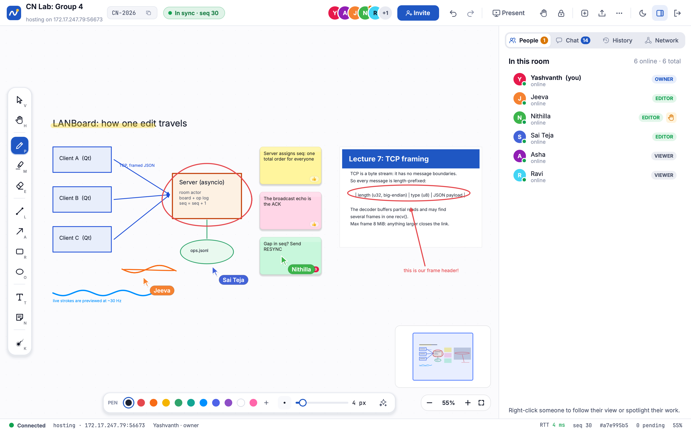

# LANBoard

A shared whiteboard for a local network: one machine runs the server, everyone else draws on the
same board, and nothing ever touches the internet.



Computer Networks Lab Project 2026, IIITDM Kancheepuram.

- Source code: <https://github.com/YashvanthSankar/cn-course-project>
- Executables for Windows, macOS and Linux: <https://github.com/YashvanthSankar/cn-course-project/releases>

## What it does

You start a server on one laptop. Everyone else opens the client, picks that server from the
*Nearby servers* list (or types its IP and port) and joins a room with a short code. From then on
every stroke, shape, sticky note and chat message shows up on all the other screens. All traffic
goes over our own framed protocol on TCP, and discovery uses UDP broadcast. There are no accounts
and no cloud service.

The parts we are most pleased with:

- **One order for every edit.** The server gives each edit a sequence number, and every client
  applies edits in that order, so all copies of the board end up the same. Duplicates, gaps and
  reordering are handled.
- **Recovery.** A late joiner gets a snapshot of the board. A client that reconnects gets only the
  edits it missed. Edits made while offline are queued and sent when the link comes back.
- **A sync badge you can trust.** The server sends a hash of its board every 25 edits. Each client
  compares it with its own copy, shows *In sync* when they match, and fetches a fresh copy by
  itself when they don't.
- **Network tab.** A live HUD (round-trip time, traffic), a frame-by-frame inspector, and a Chaos
  Lab that adds latency, drops and duplicates or "cuts the cable", so you can watch the board
  recover.
- **Working together.** Per-user undo and redo, live cursors, chat, owner/editor/viewer roles,
  password rooms, lock and kick, shapes, text, sticky notes with voting, images, PDF slides you can
  draw on, a laser pointer, follow-the-presenter, a time-lapse of the whole board history, and
  export to PNG, SVG or PDF.

The full list is in [`docs/FEATURES.md`](docs/FEATURES.md).

## Quick start

You need Python 3.12. We use [uv](https://docs.astral.sh/uv/), but plain `venv` and `pip` work too.

```bash
uv venv --python 3.12 .venv            # or: python3.12 -m venv .venv
uv pip install --python .venv/bin/python -e . pytest pytest-asyncio
```

**Start the server** on the host machine:

```bash
.venv/bin/python -m lanboard.server --port 5050            # add --dashboard for a live terminal view
```

When it starts it prints the LAN address that clients should use, for example
`Clients on this LAN can connect to: 192.168.1.20:5050`. It also answers discovery probes on
UDP port 5051.

**Start the client** on every participant's machine:

```bash
.venv/bin/python -m lanboard.client
```

- To host, choose *Host new room*. If no server is running yet, tick *Start a server on this
  computer* and the client starts one for you.
- To join, pick the server under *Nearby servers*, or type its IP and port, then enter the room code.
- For quick tests with several windows you can skip the dialog:
  `.venv/bin/python -m lanboard.client --user alice --room DEMO --create`, then the same with
  another name and without `--create`.

**Stress test.** With a server running, this starts 8 bots that draw at the same time and checks at
the end that every copy of the board matches:

```bash
.venv/bin/python -m lanboard.tools.bot --port 5050 --room DEMO --bots 8 --seconds 30
```

**Firewall notes**

- Windows: allow the server through Defender Firewall, and make sure the network profile is
  *Private*.
- macOS: allow incoming connections when asked.
- Campus Wi-Fi often blocks traffic between clients. For demos, use a phone hotspot or a small
  switch.

## Team

| Name | Roll no. | Area presented |
|---|---|---|
| Yashvanth S | CS24I1029 | Server core & state |
| Jeevanandham T | CS24I1035 | Protocol & networking |
| Akula Sai Teja | CS24I1054 | Canvas & drawing tools |
| Nithillakrishi P Y | CS24I1039 | UI & collaboration features |

Each member explains one area in the explanation video and in the viva. The same list, with the
files behind each area and the matching video, is in [`TEAM.md`](TEAM.md). Paths are relative to
`src/lanboard/`; the full module map is in [`docs/IMPLEMENTATION.md`](docs/IMPLEMENTATION.md).

- **Server core and state:** `server/server.py`, `server/room.py`, `server/persistence.py`,
  `server/dashboard.py`, the shared `common/model.py`, and the confirmed replica in
  `client/controller.py`.
- **Protocol and networking:** `common/protocol.py`, `common/messages.py`, `client/net.py`,
  `client/discovery.py`, `server/discovery.py`, the gap and duplicate handling in
  `client/controller.py`, `client/chaos.py` and `client/metrics.py`.
- **Canvas and drawing tools:** `client/canvas/`, `common/geometry.py`, `common/undo.py`.
- **UI and collaboration features:** `client/ui/` (connect dialog, main window, chat, people and
  roles, history, Network Inspector, themes) and the cross-platform builds in `packaging/`.

Shared: `common/auth.py` (password hashing and proofs) and `common/config.py` (ports, timeouts and
limits).

## How it works

The server is a single Python `asyncio` process. Each client is a PySide6 (Qt 6) app. They talk
over TCP on port 5050, and every message is one frame: a 4-byte length, a 1-byte type, then a JSON
payload. A board edit goes to the server as an op. The server checks the sender's role, gives the
op the next sequence number for the room, writes it to its log on disk and sends it to everyone in
the room, including the sender. Every client applies ops in sequence order with the same code the
server uses, so all boards stay identical.

Clients send a ping every 3 seconds, and a link that stays silent for 12 seconds is treated as
dead. A client that drops out reconnects on its own and tells the server the last sequence number it
saw, so the server sends only what it missed. Discovery is a UDP broadcast on port 5051 that each
server answers. The full design is in [`docs/ARCHITECTURE.md`](docs/ARCHITECTURE.md), and the
authoritative message catalogue is the docstring of
[`src/lanboard/common/messages.py`](src/lanboard/common/messages.py).

## Testing

```bash
.venv/bin/python -m pytest -q
```

This runs 318 tests in about a minute and a half. Besides unit tests for the framing, board model,
undo and server logic, there are integration tests over real sockets, a convergence test where six
bots edit one board while randomly disconnecting, and end-to-end tests that drive two or three real
app windows against a real server with mouse and keyboard input.

## Building standalone executables

```bash
uv pip install --python .venv/bin/python pyinstaller
.venv/bin/pyinstaller --noconfirm packaging/lanboard.spec
```

This gives you `dist/LANBoard/lanboard-server` and `dist/LANBoard/lanboard-client`, which share one
runtime folder. On Windows they end in `.exe`.

On macOS the same command also builds `dist/LANBoard.app`, a double-clickable app that holds both
programs. To wrap it in a disk image:

```bash
.venv/bin/python packaging/make_icns.py   # only if packaging/LANBoard.icns is missing
.venv/bin/python packaging/make_dmg.py    # -> dist/LANBoard-<version>-macOS.dmg
```

The app is not notarised, so the first time you open it you need to right-click it and choose
*Open*. GitHub Actions builds all three platforms (and the DMG) on every push; see
[`.github/workflows/build.yml`](.github/workflows/build.yml).

The submission zip (executables, source, documents, videos) is put together by
`.venv/bin/python packaging/make_release.py`.

## Documentation

| Document | What is in it |
|---|---|
| [`docs/LANBoard_Technical_Documentation.pdf`](docs/LANBoard_Technical_Documentation.pdf) | technical documentation and user guide (source: [`docs/TECHNICAL_DOCUMENTATION.md`](docs/TECHNICAL_DOCUMENTATION.md)) |
| [`docs/LANBoard_Presentation.pptx`](docs/LANBoard_Presentation.pptx) | the presentation deck used in the explanation video |
| [`docs/CONCEPT.md`](docs/CONCEPT.md) | the idea, scope, how the design meets the rubric, demo story |
| [`docs/FEATURES.md`](docs/FEATURES.md) | full feature list: signature, mandatory and extra features |
| [`docs/RESEARCH.md`](docs/RESEARCH.md) | whiteboards we studied for design ideas, and what we chose |
| [`docs/ARCHITECTURE.md`](docs/ARCHITECTURE.md) | architecture, wire protocol, sync and undo rules |
| [`docs/CLIENT_API.md`](docs/CLIENT_API.md) | internal contracts between client modules |
| [`docs/IMPLEMENTATION.md`](docs/IMPLEMENTATION.md) | code layout, testing and build |
| [`docs/brief/`](docs/brief/) | the original project brief (PDF) |

## Third-party software

- [PySide6 / Qt for Python](https://doc.qt.io/qtforpython-6/), LGPL-3.0
- [pypdfium2](https://github.com/pypdfium2-team/pypdfium2) (PDF page rendering), Apache-2.0 / BSD-3-Clause
- [PyInstaller](https://pyinstaller.org/) (build only), GPL-2.0 with bootloader exception
- [pytest](https://pytest.org/) / pytest-asyncio (tests only), MIT / Apache-2.0
- [Inter](https://rsms.me/inter/) and [JetBrains Mono](https://www.jetbrains.com/lp/mono/) fonts
  (bundled in `src/lanboard/client/assets/fonts`), SIL OFL 1.1
