<div class="cover">
<div class="logo">@@LOGO@@</div>
<div class="kicker">CN Lab Project 2026</div>
<h1>LANBoard: LAN-Based Multi-User Collaborative Whiteboard</h1>
<div class="subtitle">Technical Documentation and User Guide</div>
<div class="doc-kind">Python 3.12 asyncio TCP server · PySide6 (Qt 6) desktop client · LANBoard protocol v1</div>
<div class="rule"></div>
<table>
<thead><tr><th>Team member</th><th>Roll no.</th><th>Area of contribution</th></tr></thead>
<tbody>
<tr><td>Yashvanth S</td><td>CS24I1029</td><td>Server core &amp; state</td></tr>
<tr><td>Jeevanandham T</td><td>CS24I1035</td><td>Protocol &amp; networking</td></tr>
<tr><td>Akula Sai Teja</td><td>CS24I1054</td><td>Canvas &amp; drawing tools</td></tr>
<tr><td>Nithillakrishi P Y</td><td>CS24I1039</td><td>UI &amp; collaboration features</td></tr>
</tbody>
</table>
<div class="meta"><b>Date:</b> 6 November 2026 &nbsp;·&nbsp; <b>Course:</b> Computer Networks Lab &nbsp;·&nbsp; <b>Submission deadline:</b> 15 November 2026<br><b>Source of this document:</b> docs/TECHNICAL_DOCUMENTATION.md, built with docs/build/build_docs.py. Every constant, message code and worked example in it is checked against the source code at build time.</div>
</div>

[[TOC]]

## 1. Introduction

### 1.1 Purpose and scope

LANBoard is a standalone, server-based collaborative whiteboard that works only over a Local Area Network. One machine runs the **server**; any number of **clients** join a *room* and draw, write, chat and present together in real time. No Internet connection, cloud service or account is needed: everything travels over our own framed protocol on TCP port 5050, and servers are found automatically with a UDP broadcast on port 5051.

This document is the technical deliverable required by the project brief. It explains the system architecture (§2), the transport choice (§3), the application-level message format (§4), socket communication (§5), the synchronization strategy (§6), concurrency handling (§7) and recovery mechanisms (§8). It then covers performance (§9), security and access control (§10), persistence (§11), a **User Guide** (§12), testing (§13) and limitations (§14). Appendix A lists every tunable constant; Appendix B maps every requirement and rubric item of the brief to the code and the tests that cover it.

### 1.2 The problem in networking terms

A shared whiteboard is a *replicated state* problem. Every participant holds a copy of the board, every participant edits it at the same time, and the copies must stay identical even when messages are delayed, duplicated or lost, when a laptop's Wi-Fi drops for a minute, or when the server is restarted. On top of that the interactive parts (a stroke being drawn, a moving cursor) must feel instantaneous, which means small messages with low latency, while a late joiner may need a multi-megabyte board in one go.

### 1.3 Summary of the design

| Concern | Our answer |
|---|---|
| Architecture | Client–server. A central asyncio server owns every room; clients never talk to each other. |
| Transport | TCP for everything that matters (reliable, ordered byte stream); UDP only for optional LAN discovery. |
| Framing | `u32 length | u8 type | UTF-8 JSON` frames, 8 MiB cap, big payloads split into tagged parts. |
| Ordering | The server is a **sequencer**: each accepted op gets `seq = previous + 1` and is broadcast to everyone, sender included (the echo is the acknowledgement). |
| Consistency | All replicas run the same deterministic `Board.apply` in `seq` order; a board hash every 25 ops proves it at run time. |
| Responsiveness | Optimistic local apply, live-stroke batching at 33 ms, cursor throttling to 20 Hz, `TCP_NODELAY`. |
| Recovery | Snapshot for late joiners; resume token + `last_seq` for reconnects; offline queue with server-side de-duplication; write-ahead log for server crashes. |
| Access control | Password rooms (scrypt + HMAC challenge–response, the password never crosses the wire), roles owner/editor/viewer, lock, kick; every rule enforced by the server. |

### 1.4 Conventions

`C→S` means client to server, `S→C` server to one client, `S→*` server broadcast to every member of the room. Names in `monospace` are identifiers in the source tree `src/lanboard/` (paths are given relative to it). Numbers such as timeouts and limits are quoted from `common/config.py` and are listed in Appendix A.

### 1.5 Use of AI assistance

As stated in the project README, AI assistance (Anthropic's Claude) was used during development, including for parts of the code, the tests and this document. Commits made with it carry a `Co-Authored-By` trailer. The git history records who committed each change. Every number in this document is checked against the code by the build script.

## 2. System architecture

### 2.1 Deployment on a LAN

Figure 1 shows a typical deployment. Any laptop on the LAN can host the server, either from a terminal (`lanboard-server`) or from the client's *Host* screen, which starts the server as a child process. Clients first find servers with a UDP broadcast (optional; the address can also be typed), then open one persistent TCP connection each.

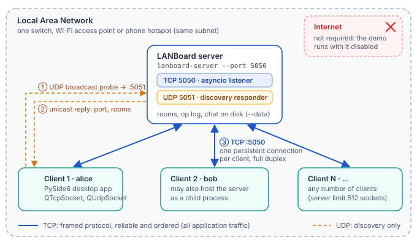

### 2.2 Components and layers

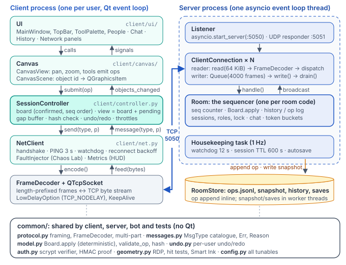

**Client.** The UI never touches sockets or the board directly. Canvas tools never mutate scene items: they call `SessionController` methods (`add_object`, `update_many`, `delete_objects`), the controller applies the op to its *view* board, and the scene re-renders from it, exactly as for a remote user's op. One code path therefore serves local and remote changes. `NetClient` owns the TCP socket, the handshake, the heartbeat and reconnection, and hands decoded frames to the controller through a Qt signal.

**Server.** One asyncio event loop serves every socket. Each connection has a reader task and a writer task; each room is a `Room` object that sequences ops, holds the authoritative board, the op history, the members and the chat. A housekeeping task runs once a second (watchdog, session expiry, autosave). Slow file writes run in worker threads.

**Shared core.** `common/` contains the framing codec, the message catalogue, the board model and `apply`, undo logic, password helpers, geometry and all constants. It has no Qt dependency, so the server, the client, the headless test bot and the tests all run *the same* `Board.apply`, which is the basis of convergence.

### 2.3 Source code map

| Module | Responsibility | Owner |
|---|---|---|
| `common/protocol.py` | `encode`, incremental `FrameDecoder`, multi-part split (`encode_parts`) and `PartAssembler` | Jeevanandham |
| `common/messages.py` | `MsgType` codes, payload contracts (docstring), `Err`, `Reason` | Jeevanandham |
| `common/model.py` | `Board`, `apply`, `normalise`, `validate_op`, `hash` | Yashvanth, Akula |
| `common/undo.py` | per-user `UndoManager`, inverse ops, conflict filtering | Akula |
| `common/auth.py`, `common/config.py`, `common/geometry.py` | scrypt/HMAC, tunables, RDP / hit tests / Smart Ink | team |
| `server/server.py` | listener, `ClientConnection` (reader/writer), handshake, watchdog | Yashvanth |
| `server/room.py` | `Room` sequencer, op pipeline, sessions, roles, chat, saves, history, blobs | Yashvanth |
| `server/persistence.py` | snapshot + write-ahead op log + history archive, atomic writes | Yashvanth |
| `server/discovery.py`, `server/dashboard.py` | UDP discovery responder, live terminal dashboard | Jeevanandham, Yashvanth |
| `client/net.py`, `chaos.py`, `metrics.py`, `discovery.py` | TCP client, Chaos Lab fault injector, HUD metrics, UDP browser | Jeevanandham |
| `client/controller.py` | replica, optimistic view, gap/duplicate handling, hash check, undo, throttling | Jeevanandham, Akula |
| `client/canvas/*` | `CanvasView`, `CanvasScene`, items, tools, minimap, export | Akula |
| `client/ui/*` | main window, connect dialog, panels (people, chat, history, network), theme | Nithillakrishi |
| `tools/bot.py` | headless protocol client and stress tool | Jeevanandham |

### 2.4 Technology choices

* **Python 3.12 + asyncio** for the server: one thread multiplexes all sockets with the OS readiness API (kqueue, epoll, IOCP), so room state needs no locks (§7).
* **PySide6 (Qt 6)** for the client: `QGraphicsScene` gives hit-testing, zoom, selection and export; `QTcpSocket`/`QUdpSocket` are signal-driven and run on the GUI event loop, so the client needs no threads either.
* **JSON payloads** inside binary length-prefixed frames: debuggable in our Network Inspector, compact enough with integer/one-decimal coordinates and compact separators.
* **PyInstaller** one-folder bundles produce the two standalone executables `lanboard-server` and `lanboard-client` (shared runtime folder), built on Windows, Linux and macOS by CI.

### 2.5 The shared data model

The board is a dictionary of objects keyed by a globally unique id `"<user_id>-<tag><counter>"`, created by the client without a round trip. Objects are plain JSON dicts:

```
{"id": "u3-3f2a7", "type": "stroke", "owner": "u3", "z": 12,
 "style": {"color": "#e6194b", "width": 4}, "geom": {"pts": [10, 20, 14, 26]},
 "off": [0, 0], "deleted": false, "rev": 57}
```

Object types: `stroke`, `line`, `arrow`, `rect`, `ellipse`, `text`, `sticky`, `image`. `owner` is forced by the server to the submitting user, `off` is a translation (a cheap "move"), `deleted` is a tombstone kept so undo/restore stay well defined, and `rev` is the seq of the last op that changed the object. Every change is an **op**:

| `op.k` | Fields | Meaning | Inverse (undo) |
|---|---|---|---|
| `add` | `obj` | create an object (duplicate id = no-op) | `delete [id]` |
| `update` | `id, set, prev` | set keys `off`, `z`, `votes`, `style.*`, `geom.*` | `update` with `set` and `prev` swapped |
| `delete` | `ids` | tombstone live objects | `restore ids` |
| `restore` | `ids` | bring tombstoned objects back | `delete ids` |
| `clear` | – | normalised by the server to `delete {ids: all live, clear: true}` | `restore` of those ids |
| `replace` | `objects` | load a save / restore a version (owner only) | not undoable |
| `batch` | `ops` (≤ 500, no nesting) | several ops as one atomic, single-undo step | inverse of each part, reversed |

`apply` is **deterministic and total**: an op that no longer makes sense (updating an object somebody already erased, deleting a tombstone) is a no-op, never an error. Same ops in the same order therefore always give the same board.

## 3. Transport protocol choice

### 3.1 Why TCP for all whiteboard traffic

| Requirement | TCP | UDP |
|---|---|---|
| Every op must arrive (a lost stroke is a lost update) | retransmission built in | we would have to add ACKs and retransmission |
| Ops must be applied in one order | in-order byte stream per connection | datagrams can be reordered; we would need sequencing and buffering |
| Large payloads (snapshot of a full board, images) | arbitrary stream, flow control, congestion control | 64 KiB datagram limit, IP fragmentation, our own segmentation |
| Detecting a dead peer | connection state, FIN/RST, keep-alive | none: we would need our own sessions |
| Broadcast to unknown hosts | impossible | yes |
| Latency on a LAN | sub-millisecond with `TCP_NODELAY` | slightly lower, no head-of-line blocking |

On a LAN, loss is rare and round trips are below a millisecond, so TCP's only real cost (head-of-line blocking after a lost segment) is negligible, while re-implementing reliability, ordering, flow control and segmentation over UDP would add a lot of code and bugs for no gain. The rubric's requirement that "all essential communication must operate over TCP/IP sockets" is met directly.

### 3.2 Why UDP for discovery

Users should not have to type an IP address. A client cannot open a TCP connection to "whoever is a LANBoard server", but it can send one UDP datagram to the broadcast address, which every host on the subnet receives. Discovery tolerates loss (it is simply repeated every 2 s), needs no connection state, and broadcasts do not cross routers, which matches the LAN-only scope. If discovery is blocked (some campus Wi-Fi), the server address can always be typed manually.

### 3.3 Socket options

* **`TCP_NODELAY`** on both ends (`setsockopt(IPPROTO_TCP, TCP_NODELAY, 1)` on every accepted socket; `QAbstractSocket.LowDelayOption` on the client). Nagle's algorithm holds back a small segment until earlier data is acknowledged; combined with delayed ACKs that can add up to about 200 ms to a cursor move or a live-stroke batch.
* **`SO_KEEPALIVE`** on both ends as an OS-level backstop. Our own heartbeat (§5.4) detects dead peers in seconds; OS keep-alive alone would take hours.
* **Address reuse**: the listener uses the platform default (`reuse_address=None`): `SO_REUSEADDR` on POSIX so a restart does not wait for `TIME_WAIT`, but not on Windows, where it would let a second server silently share the port.

### 3.4 What TCP does not solve

TCP hides loss, duplication and reordering *within one connection*. It does not help when the connection itself dies: ops in flight are lost with it, a reconnect is a new byte stream, and the client may have edited offline. It also gives no ordering *across* clients. Those cases are handled by the application layer: server sequence numbers give a global order, op ids make resends idempotent, `last_seq` lets a reconnecting client fetch exactly what it missed, and hash checkpoints catch any divergence. The Chaos Lab (§12.12) injects drops, duplicates and delays above TCP to demonstrate that logic live.

## 4. Application-level message format

### 4.1 Framing

TCP is a byte stream without message boundaries: one `recv()` may return half a frame or three frames. Every message is therefore framed with a length prefix (Figure 3).

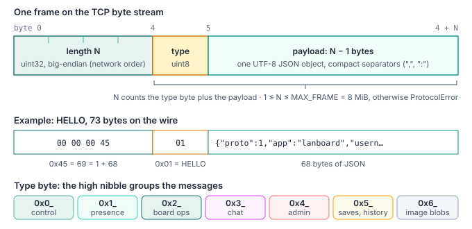

The decoder (`protocol.FrameDecoder`) is incremental: it appends whatever bytes arrived to a buffer, extracts every complete frame and keeps the rest. A length of 0 or above `MAX_FRAME` (8 MiB), invalid UTF-8/JSON, or a payload that is not a JSON object raises `ProtocolError`; the server answers `ERROR BAD_MESSAGE` and closes the connection, because frame boundaries in a corrupt stream cannot be recovered. The same decoder is used by the server, the client and the bot.

### 4.2 Payload encoding rules

* Payloads are one JSON object, encoded with `separators=(",", ":")` and `ensure_ascii=False` (UTF-8, no spaces).
* Point lists are flat `[x0, y0, x1, y1, …]` arrays, rounded to 0.1 after simplification.
* All keys are required unless marked `?` in the catalogue. Unknown message types from a joined client are a protocol violation.
* Ids, roles and user ids are always assigned by the server; client-supplied `owner` or `user_id` fields are overwritten.

### 4.3 Message catalogue

The authoritative catalogue is the docstring of `common/messages.py`. The table below lists all 42 message types; the build script checks it against the `MsgType` enum.

| Code | Name | Dir. | Payload fields and notes |
|---|---|---|---|
| `0x01` | `HELLO` | C→S | `{proto, app, username, client_id}`; must be the first frame |
| `0x02` | `CHALLENGE` | S→C | `{nonce, server_id, server_name, proto}`; fresh single-use nonce |
| `0x03` | `JOIN` | C→S | `{room, create, name?, password?:{salt, verifier}` (create only)`, proof?, resume_token?, last_seq?}` |
| `0x04` | `JOINED` | S→C | `{user_id, username, color, role, resume_token, resumed, room, participants, chat` (last 200)`, server_time}`; always followed by SNAPSHOT or OP_BATCH |
| `0x05` | `SNAPSHOT` | S→C | `{seq, board:{seq, objects}, hash, part?, parts?, xid?}` |
| `0x06` | `OP_BATCH` | S→C | `{ops:[OpMsg]}`; catch-up, ≤ 500 ops and ≈ 1 MiB per frame |
| `0x07` | `ERROR` | S→C | `{code, msg, salt?, nonce?}` (auth errors carry salt + fresh nonce; blob errors carry `hash`) |
| `0x08` | `PING` | C→S | `{t, rtt?}`; every 3 s; `rtt` is the client's last measurement (for the dashboard) |
| `0x09` | `PONG` | S→C | `{t, server_time}`; `t` echoed so RTT = now − t |
| `0x0A` | `LEAVE` | C→S | `{}`; graceful leave, session removed |
| `0x0B` | `RESYNC` | C→S | `{last_seq}`; gap detected; `-1` asks for a full SNAPSHOT |
| `0x0C` | `HASH` | S→* | `{seq, hash}`; every 25th seq and after a `replace` |
| `0x0D` | `LIST_ROOMS` | C→S | `{}` (allowed before joining) |
| `0x0E` | `ROOMS` | S→C | `{rooms:[{code, name, users, protected, locked}]}` |
| `0x10` | `USER_JOINED` | S→* | `{participant}` |
| `0x11` | `USER_LEFT` | S→* | `{user_id, reason}` |
| `0x12` | `USER_UPDATE` | S→* | `{participant}`; role, online or raised-hand change |
| `0x13` | `CURSOR` | C→S, S→* | `{x, y}`; relayed with `user_id`; ≤ 20 Hz |
| `0x14` | `STROKE_LIVE` | C→S, S→* | `{id, color, width, pts, tool?}`; new points only, batched every 33 ms |
| `0x15` | `STROKE_END` | C→S, S→* | `{id}`; live preview finished or cancelled |
| `0x16` | `LASER` | C→S, S→* | `{pts}`; fading pointer trail, never saved |
| `0x17` | `VIEWPORT` | C→S, S→* | `{x, y, w, h}`; owner or presenter only, for "follow the presenter" |
| `0x18` | `SIGNAL` | C→S, S→* | `{kind}`: `hand_up`/`hand_down` (become USER_UPDATE), `ping:x,y` |
| `0x20` | `OP_SUBMIT` | C→S | `{op_id, op}`; `op_id = "<client_id>:<counter>"` |
| `0x21` | `OP` | S→* | OpMsg `{seq, user_id, op_id, ts, op}`; the echo to the sender is its ack |
| `0x22` | `OP_REJECT` | S→C | `{op_id, code, msg}`; no seq consumed, client rolls back |
| `0x30` | `CHAT_SEND` | C→S | `{cmid?, text}`; ≤ 2000 characters |
| `0x31` | `CHAT` | S→* | `{id, user_id, username, color, ts, text, kind:"user"|"system", cmid?}` |
| `0x40` | `SET_ROLE` | C→S | `{user_id, role}`; owner only; role `owner` = transfer |
| `0x41` | `KICK` | C→S | `{user_id}`; owner only |
| `0x42` | `ROOM_SETTINGS` | C→S | `{locked?, name?, editors_can_clear?, password?:{salt, verifier}|null, presenter?}`; owner only |
| `0x43` | `ROOM_UPDATE` | S→* | `{room:RoomInfo}` |
| `0x50` | `SAVE` | C→S | `{name}`; owner and editors |
| `0x51` | `LIST_SAVES` | C→S | `{}` |
| `0x52` | `SAVES` | S→C | `{saves:[{name, ts, objects}]}` |
| `0x53` | `LOAD` | C→S | `{name}`; owner only, executed as a `replace` op |
| `0x54` | `HISTORY_REQ` | C→S | `{}` |
| `0x55` | `HISTORY` | S→C | `{base_seq, base:{seq, objects}, ops, part?, parts?, xid?}` |
| `0x60` | `BLOB_PUT` | C→S | `{hash, mime, size, index, count, data}` (base64 chunk of 192 KiB) |
| `0x61` | `BLOB_GET` | C→S | `{hash}` |
| `0x62` | `BLOB_DATA` | S→C | same fields as BLOB_PUT |
| `0x63` | `BLOB_STORED` | S→C | `{hash}`; all chunks received and SHA-256 verified |

Messages `0x13`–`0x18` are **ephemeral**: never logged, no seq, relayed only to the other members and dropped silently above 240 frames per second per client.

### 4.4 Shared shapes, error codes and leave reasons

* `RoomInfo = {code, name, locked, protected, editors_can_clear, owner_id, presenter}`
* `Participant = {user_id, username, color, role, online, hand}`

| Error code | Meaning | Fatal for the client? |
|---|---|---|
| `PROTO_MISMATCH` | client and server speak different protocol versions | yes |
| `BAD_MESSAGE` | the payload violates the contract; the connection is closed | – |
| `NOT_JOINED` | room message before JOIN | no |
| `ROOM_NOT_FOUND`, `ROOM_EXISTS` | join of an unknown room / create of an existing code | yes |
| `AUTH_REQUIRED`, `BAD_PASSWORD` | password needed / wrong (carry salt + fresh nonce) | no: prompt |
| `FORBIDDEN`, `LOCKED` | role or lock forbids the action | during join only |
| `INVALID_OP`, `TOO_LARGE`, `RATE_LIMITED` | op rejected (OP_REJECT) | no |
| `KICKED` | removed by the owner | yes |
| `NOT_FOUND`, `SERVER_FULL` | unknown user/save/blob; more than 512 connections | `SERVER_FULL` yes |

`USER_LEFT.reason` is one of `left`, `timeout`, `disconnected`, `kicked`, `lagging`, `expired` (resumable session expired, the user is gone for good).

### 4.5 Multi-part messages

A whole board or the whole time-lapse can exceed one frame. A SNAPSHOT or HISTORY payload larger than `PART_BYTES` (1 MiB) is sent as `parts` consecutive frames of the same type tagged `{part, parts, xid}`. Every part repeats the scalar fields (`seq`, `hash`, `base_seq`) and carries a slice of the big lists (`board.objects`; `base.objects` then `ops`). The receiver's `PartAssembler` stores parts by index (any order, duplicates ignored, at most 4 unfinished transfers) and returns the merged payload only when every part has arrived, so a board is never applied half-loaded. The server queues all parts of a SNAPSHOT in one synchronous call, so no OP is interleaved between them. A long catch-up is several independent OP_BATCH frames (each op carries its own seq, so no reassembly is needed). A single op whose OP frame would exceed `MAX_OP_BYTES` (4 MiB) is refused with `OP_REJECT TOO_LARGE`; the connection stays up.

### 4.6 Worked examples

The bytes below are produced by `lanboard.common.protocol.encode` (the build script recomputes them). The `client_id` is shortened for readability; real ones are 32 hex digits.

**HELLO** (`0x01`), 73 bytes on the wire. The first four bytes `00 00 00 45` are the length 69 = 1 type byte + 68 payload bytes:

```
0000  00 00 00 45 01 7b 22 70 72 6f 74 6f 22 3a 31 2c  ...E.{"proto":1,
0010  22 61 70 70 22 3a 22 6c 61 6e 62 6f 61 72 64 22  "app":"lanboard"
0020  2c 22 75 73 65 72 6e 61 6d 65 22 3a 22 61 6c 69  ,"username":"ali
0030  63 65 22 2c 22 63 6c 69 65 6e 74 5f 69 64 22 3a  ce","client_id":
0040  22 33 66 32 61 39 63 22 7d                       "3f2a9c"}
```

**OP_SUBMIT** (`0x20`) of a three-point stroke, 161 bytes. Header `00 00 00 9d 20`, then:

```
{"op_id":"3f2a9c:7","op":{"k":"add","obj":{"id":"u3-3f2a7","type":"stroke","z":4,"style":{"color":"#e6194b","width":4},"geom":{"pts":[10,20,14,26,21,30]}}}}
```

The server answers every member with the **OP** (`0x21`) below, 218 bytes, header `00 00 00 d6 21`. It adds `seq`, `user_id`, a server timestamp and forces `owner`:

```
{"seq":42,"user_id":"u3","op_id":"3f2a9c:7","ts":1762400000.123,
 "op":{"k":"add","obj":{"id":"u3-3f2a7","type":"stroke","z":4,"owner":"u3",
       "style":{"color":"#e6194b","width":4},"geom":{"pts":[10,20,14,26,21,30]}}}}
```

Feeding the three frames to one `FrameDecoder` in 7-byte chunks yields exactly `HELLO, OP_SUBMIT, OP`; this is what `test_protocol.py` checks byte by byte.

### 4.7 Discovery datagrams

Discovery is not framed (one JSON object per datagram). Probe, to `255.255.255.255`, every interface's directed broadcast address and `127.0.0.1`, port 5051: `{"magic": "LANBOARD_DISCOVER_V1"}`. Reply, unicast to the probe's source address and port: `{magic, server_id, name, port, proto, tls, rooms:[{code, name, users, protected, locked}] (≤ 40), host?}`. The client takes the server's IP from the datagram's *sender address*, which is the address it can actually reach. Probes repeat every 2 s; a server is forgotten after 6 s without a reply; replies are de-duplicated by `server_id`.

## 5. Socket communication

### 5.1 Server sockets and connection tasks

`asyncio.start_server` binds `0.0.0.0:5050` (configurable with `--host`/`--port`). For each accepted socket the server sets `TCP_NODELAY` and `SO_KEEPALIVE` and creates a `ClientConnection` with two coroutines:

* **reader**: `await reader.read(65536)` → `FrameDecoder.feed` → `dispatch` for each complete frame. Any received byte updates `last_seen`.
* **writer**: takes pre-encoded frames from a bounded `asyncio.Queue` (4000 frames), `write()`s them and `await drain()`s, which suspends while the kernel send buffer is full (TCP flow control).

Handlers and broadcasts only call `put_nowait` on the queue, so producing a message never waits on the network. A connection is a small state machine: `hello` (only HELLO and PING accepted) → `lobby` (LIST_ROOMS, JOIN) → `joined` (room messages routed to `Room.handle`). Above 512 connections a new socket gets `ERROR SERVER_FULL` and is closed.

### 5.2 Client socket and handshake state machine

`NetClient` uses `QTcpSocket`, which is asynchronous: every call returns at once and progress arrives as Qt signals (`connected`, `readyRead`, `disconnected`, `errorOccurred`) on the GUI thread. Each attempt gets a fresh socket, decoder and *generation number*, so bytes or delayed Chaos-Lab frames from an old connection can never leak into a new one. Public states:

| State | Meaning |
|---|---|
| `connecting` | TCP connect in progress, then HELLO sent |
| `authenticating` | CHALLENGE received, JOIN sent, possibly answering a password challenge |
| `joined` | JOINED received; ops, chat and presence flow |
| `reconnecting` | link lost after a successful join; backoff timer running; whole resume handshake |
| `closed` | fatal error (`PROTO_MISMATCH`, `ROOM_NOT_FOUND`, `ROOM_EXISTS`, `KICKED`, `FORBIDDEN` during join), a failed *first* connection (reported as `CONNECT_FAILED`), or the user left |

### 5.3 Join and late join

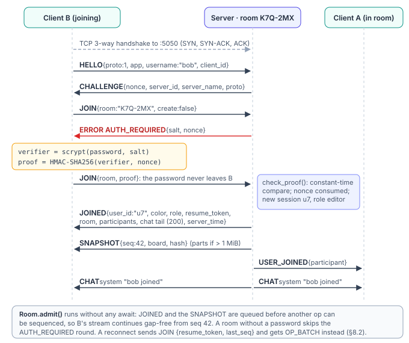

`Room.admit` sends JOINED, then the catch-up, then `USER_JOINED` to everyone else, without an `await` in between. Because the event loop runs one callback at a time, no op can be sequenced between registering the newcomer and queueing its snapshot, so the newcomer's stream is gap-free. The encoded SNAPSHOT is cached per seq, so many late joiners at the same moment cost one encode.

### 5.4 Heartbeat, RTT and dead-peer detection

A pulled cable or a sleeping laptop produces no FIN or RST, so the TCP connection stays half-open and `read()` would wait forever. Therefore:

* the client sends `PING {t, rtt}` every 3 s with a monotonic timestamp; the server echoes `t` in PONG, so `RTT = now − t` without clock synchronisation (shown in the HUD and status bar);
* the server's housekeeping task closes any connection silent for more than 12 s (`USER_LEFT {reason: "timeout"}`), any frame counting as activity;
* the client's watchdog declares the link dead when nothing has arrived for 12 s (the server answers every PING, so a healthy link always carries data), aborts the socket and reconnects (§8.2). The same watchdog bounds a TCP connect to an unreachable host.

### 5.5 Closing: graceful leave vs. abrupt loss

*Leave room* sends `LEAVE`, flushes, and closes with `disconnectFromHost()`, which sends a FIN after the write buffer drains; the server removes the session (`reason: "left"`). A lost link or Chaos Lab "cut cable" uses `abort()` (RST, unsent data discarded); the server only *detaches* the session, which stays resumable for 600 s. After an ERROR the server closes with `flush=True`: it lets the writer send what is queued, with a 5 s grace period for a peer that never reads.

### 5.6 Flow control and slow receivers

If a client cannot keep up (weak Wi-Fi, frozen process), its TCP window closes, `drain()` blocks its writer, and its queue fills. When `put_nowait` finds the queue full (4000 frames) the server closes *that* connection with reason `lagging`, deferred with `call_soon` so membership never changes in the middle of a broadcast. The client reconnects and resumes; nobody else is slowed down.

## 6. Synchronization strategy

### 6.1 Total order through a central sequencer

LANBoard implements a **total-order broadcast** with a fixed sequencer, the room. The server assigns every accepted op `seq = previous seq + 1`, applies it to its own board, appends it to the log and broadcasts it to all members including the sender. Each client applies OPs strictly in seq order with the shared deterministic `Board.apply`. Hence every replica that has applied the ops up to seq *n* holds the identical board *n*. This is the state-machine replication idea of Lamport [6] with the server as the single orderer; it needs no clocks and no conflict-resolution protocol between clients.

### 6.2 The op pipeline on the server

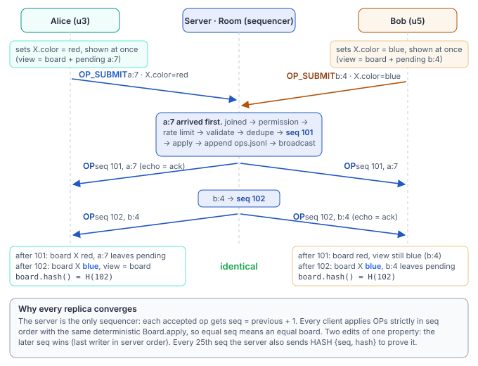

`Room.submit` runs these steps synchronously for every `OP_SUBMIT`:

1. **joined**: the session must still belong to the room;
2. **permission**: viewers cannot edit; a locked room accepts ops only from the owner; `clear` needs the owner (or `editors_can_clear`); `replace` is owner only;
3. **rate limit**: token bucket of 120 ops/s per user;
4. **validate**: `validate_op` checks kinds, types, ids, geometry keys, coordinate bounds (±1,000,000), list sizes; the board may hold at most 50,000 objects;
5. **dedupe**: an `op_id` already accepted from this user is acknowledged again by re-sending its original OP to the sender only; it is never applied twice;
6. **normalise**: `clear` becomes `delete` of the currently live ids (so it is undoable and deterministic); `add.owner` is forced to the sender;
7. **size check**: the OP frame is encoded once; above 4 MiB it is refused with `TOO_LARGE` and no seq is consumed;
8. **sequence and apply**: `seq += 1`, `board.apply(op, seq)`;
9. **log**: append to `ops.jsonl` (write-ahead) and to the in-memory history *before* anyone sees the op;
10. **broadcast**: the same encoded bytes are queued for every member; every 25th seq (and after a `replace`) a `HASH {seq, hash}` follows.

A rejected op gets `OP_REJECT {op_id, code, msg}` and the client rolls it back.

### 6.3 The client replica: confirmed board and optimistic view

`SessionController` keeps two boards:

* `board` (**confirmed**): only server-ordered ops, applied in seq order; identical on every client at the same seq;
* `view` = `board` + our own **pending** ops (sent, not yet echoed). The canvas renders `view`, so a stroke appears the instant the pen is lifted, without waiting a round trip.

When the echo of a pending op arrives it is applied to `board` and leaves `pending`; when a foreign op arrives while ops are pending, `view` is rebuilt as `board` + pending, and only the objects whose rendering changed are redrawn. On `OP_REJECT` the op is dropped from pending and the view rebuilt, so the local edit disappears and a toast explains why.

### 6.4 Delivery rules: duplicates, gaps, reordering

| Incoming OP | Rule (client `_on_op`) |
|---|---|
| `seq ≤ board.seq` | duplicate (re-sent, or Chaos-duplicated): dropped, so delivery is idempotent |
| `seq = board.seq + 1` | in order: applied, then any buffered successors are drained |
| `seq > board.seq + 1` | gap: buffered in a reorder map; if the gap is not filled within 400 ms, or more than 256 ops are buffered, the client sends `RESYNC {last_seq}` |

The server answers RESYNC with an OP_BATCH of the missing tail from its history, or with a SNAPSHOT if the tail is older than the history base or more than 5000 ops long. On the server side, duplicates are handled by the per-session `op_id` table (up to 4096 remembered ids, rebuilt from the log after a restart).

### 6.5 Consistency checkpoints and self-healing

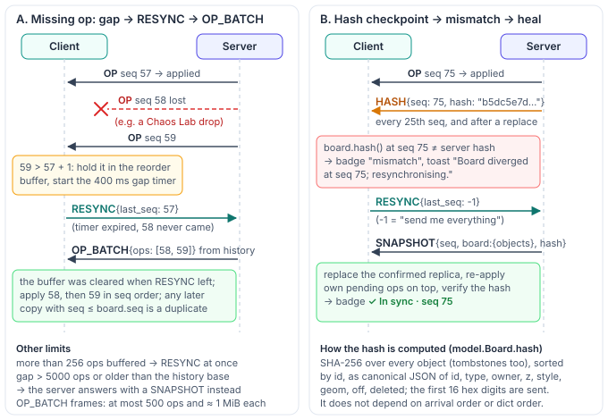

`Board.hash` is a SHA-256 over the canonical JSON of every object (tombstones included) sorted by id, truncated to 16 hex digits; it does not depend on arrival or dictionary order. A client that receives `HASH {seq, hash}` compares it when its own board reaches that seq. On a mismatch it shows a warning, sends `RESYNC {last_seq: -1}` and replaces its replica with the SNAPSHOT. The badge in the top bar ("✓ In sync · seq N", "pending", "healing", "offline", "mismatch") reports this state, so consistency is visible evidence, not a claim.

### 6.6 Concurrent edits of the same object

* Two `update`s of the same property: both are applied in seq order, so the later seq wins everywhere (last writer by server order). Different properties of one object both survive.
* `update` or `delete` of an object that was erased meanwhile: no-op on every replica.
* Concurrent `add`s never collide, because object ids embed the creator's user id and a per-client tag.
* `clear` deletes exactly the ids that were live *at its seq*; objects added later by others are untouched.

### 6.7 Ephemeral traffic

Cursor positions, live stroke previews, the laser pointer, presenter viewports and signals are not part of the board. They carry no seq, are never logged, are relayed only to the *other* members and may be lost without harm: a live preview is always replaced by the committed `add` op (same id) and closed by `STROKE_END`. Viewers' and (in a locked room) non-owners' live strokes are not relayed.

### 6.8 Undo and redo with several users

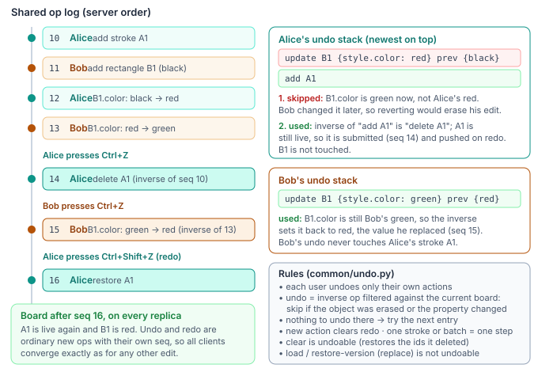

Undo is not "rewind the log". Each user has their own stack (at most 500 entries) of their own actions. Undo computes the inverse op, **filters it against the current board** and submits it as a brand-new op with its own seq, so every replica converges exactly as for any other edit:

* undo of `add X` → `delete X`, skipped if X was already erased by someone;
* undo of `delete X` → `restore X`, skipped if X is live again;
* undo of `update X.k` → set `k` back, only for keys that still hold *our* value; if another user changed `k` since, their newer edit is kept;
* undo of a `batch` (e.g. moving a multi-selection, one pen stroke) → inverse of each part in reverse order: one step;
* an entry whose filtered inverse is empty is skipped and the next one tried; a new action clears the redo stack; `replace` (load / restore version) is not undoable; `clear` is (it restores the ids it tombstoned).

### 6.9 Alternatives considered

*Operational Transformation* and *CRDTs* allow peer-to-peer editing without a central orderer, but they are complex and unnecessary when the brief mandates a central server. A peer-to-peer mesh would need N² connections and has no natural authority for permissions. A central sequencer gives a total order with one counter, makes server-side access control trivial and keeps every client simple.

## 7. Concurrency handling

### 7.1 Server: one event loop, no locks

The entire server runs on one asyncio event loop thread. Every mutation of a room (board, op log, members, chat, settings) happens in a synchronous method called from that thread, and a synchronous method cannot be interrupted half-way. Two clients therefore can never race on room state, which is why `room.py` contains no locks. Concurrency comes from multiplexing: while one connection's coroutine waits for bytes, the loop serves all others.

### 7.2 Await points and re-checks

The few `await` points (disk I/O through `asyncio.to_thread`, history encoding) are placed *after* the in-memory state has been captured or changed. Code that resumes after an await re-checks what may have changed meanwhile: for example `on_history_req` only sends if `s.conn` is still the same connection, and blob uploads re-check the connection after the existence check. One HISTORY request per user is in flight at a time.

### 7.3 Per-client output queues

Broadcast encodes a frame **once** and queues the same `bytes` object for every member with `put_nowait`. A slow receiver can never stall the room or another client (§5.6). The dashboard (`--dashboard`) shows each client's queue depth as an early warning.

### 7.4 Disk I/O off the loop

Appends to `ops.jsonl` and `chat.jsonl` are cheap buffered writes done inline (so the op is durable before it is broadcast). Snapshots, saves, history rewrites and blob files are written by worker threads. The snapshot task captures a deep copy of the board and the list of ops to archive on the loop thread first, so the thread writes a consistent point-in-time image, and only one snapshot per room runs at a time.

### 7.5 Rate limiting and resource caps

| Resource | Limit |
|---|---|
| committed ops | token bucket 120/s per user (`RATE_LIMITED`) |
| ephemeral frames | 240/s per user, excess dropped silently |
| chat | 5 messages/s, burst 10 |
| frame / op / blob | 8 MiB frame, 4 MiB op frame, 8 MiB image, 4 concurrent uploads per connection |
| board / text / stroke | 50,000 objects, 5000 characters, 20,000 coordinates |
| connections | 512; wrong passwords: 10 per connection |

### 7.6 Client: everything on the Qt event loop

`QTcpSocket`, `QUdpSocket` and all timers (ping, watchdog, reconnect, live flush, cursor throttle, gap timer) run on the GUI thread. There are no worker threads in the client networking path and so no locks; signals carry payload dicts by reference (`Signal(object)`) to avoid copying large snapshots.

### 7.7 Stress results

The stress tool (`python -m lanboard.tools.bot`) runs N headless clients that draw, move, recolour and delete at a fixed rate and finally compare each replica's hash with the server's. Run on 6 November 2026, server and bots on the same development laptop (loopback, so this measures the software, not the LAN):

| Run | Ops acknowledged | Throughput | Frames received by bots | RTT | Result |
|---|---|---|---|---|---|
| 8 bots × 20 ops/s, 10 s | 1,461 | 145.4 ops/s | ≈ 1,200 per s | 0.2–1.0 ms | all 8 replicas converged; 58 hash checks each, 0 mismatches, 0 resyncs |
| 32 bots × 10 ops/s, 8 s | 1,481 | 174.1 ops/s | ≈ 4,250 per s | (bot process saturated) | all 32 replicas converged |

## 8. Recovery mechanisms

### 8.1 Failure model

| Failure | Detection | Recovery |
|---|---|---|
| late join | – | JOINED + full SNAPSHOT (multi-part if large) |
| lost / reordered / duplicated OP (Chaos Lab, reconnect) | seq gap or `seq ≤ board.seq` | reorder buffer, RESYNC → OP_BATCH; duplicates dropped |
| replica divergence (should never happen) | HASH mismatch | RESYNC −1 → SNAPSHOT |
| Wi-Fi drop, cable pull, sleep | 12 s silence, FIN/RST, socket error | backoff reconnect, resume with token + `last_seq` |
| edits made while offline | ops stay pending | resent in order after JOINED; server dedupes by `op_id` |
| slow client | send queue full | dropped as `lagging`, then resumes |
| server killed or crashed | – | snapshot + replay of `ops.jsonl` on start; sessions and tokens survive |
| server restarted cleanly | – | final snapshot on SIGINT/SIGTERM |
| owner leaves for good | session removed / expired after 600 s | ownership passes to the earliest online editor |

### 8.2 Reconnect and session resume

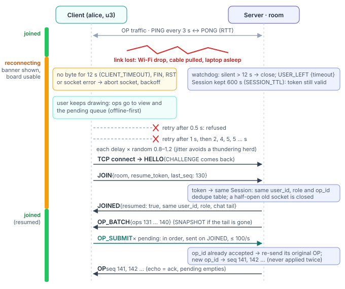

A `Session` (user id, role, resume token, op-id table) outlives its TCP connection for 600 s. After a link loss the client retries after 0.5, 1, 2, 4, 5, 5 … s, each multiplied by a random factor in [0.8, 1.2] so that many clients that lost the server at once do not reconnect in lock-step. The reconnect JOIN carries `resume_token` and `last_seq`; the server re-attaches the same session (closing a half-open old socket if any) and sends `OP_BATCH` with the ops after `last_seq`, or a SNAPSHOT if those are no longer available. During the whole handshake the UI shows one steady "reconnecting" banner and the board stays usable. An unknown token is treated as a fresh join.

### 8.3 Offline-first editing

While disconnected the user keeps drawing: ops are applied to the view and kept in `pending`. After every JOINED the controller resends all pending ops in their original order, paced at 100 per second to stay under the server's 120 ops/s bucket. Ops the server had already accepted before the link died are recognised by `op_id` and only re-acknowledged; the others get new seqs. Image uploads made offline are queued as well.

### 8.4 Server crash and restart

Each room directory holds a classic snapshot + write-ahead log:

| File | Contents | Written |
|---|---|---|
| `room.json` | code, name, salt/verifier, settings, sessions with resume tokens | atomically when dirty |
| `snapshot.json` | board at seq S | atomically at each compaction |
| `ops.jsonl` | every op after S | appended *before* the op is broadcast |
| `history_base.json`, `history.jsonl` | base board and every op from it up to S (time-lapse archive) | at compaction |
| `chat.jsonl`, `saves/`, `blobs/` | chat log, named saves, images by SHA-256 | append / atomic |

Compaction runs after 50 ops or 10 s (whichever comes first): ops are first appended to `history.jsonl`, then `snapshot.json` is replaced, then `ops.jsonl` is truncated to the ops sequenced meanwhile. A crash between any two steps loses nothing: the loader skips ops it already has (by seq) and stops at a gap. On start the server loads every room: snapshot + replay of later ops; the op-id tables are rebuilt from the log, so a client resuming after a server restart is still deduplicated correctly; user ids are never reused (the counter is persisted). The history is capped at 100,000 ops and 32 MiB per room; beyond that the oldest ~10 % are folded into the base board.

### 8.5 Torn files and Windows file replacement

Whole-file writes go to a temporary file, are `fsync`-ed and then `os.replace`-d, which is atomic on POSIX and on Windows (`MoveFileEx` with replace-existing). On Windows a virus scanner or indexer briefly holding the target makes the replace fail, so it is retried for about a second. Appends are flushed but not fsync-ed: a killed process loses nothing; a power cut may tear the last line, which the loader skips; before appending to such a file the server first writes a newline so the next record is not glued onto the broken one.

### 8.6 Ownership hand-over

When the owner's session is removed (leave, kick, or expiry after 600 s offline) ownership passes to the earliest-joined online editor, else to anyone online, announced by USER_UPDATE, ROOM_UPDATE and a chat notice. The owner may also transfer ownership explicitly (`SET_ROLE role=owner`).

## 9. Performance and traffic minimisation

### 9.1 Techniques

* **Live-stroke batching**: points are collected and flushed as one `STROKE_LIVE` every 33 ms (≈ 30 Hz) instead of one frame per mouse event (120 Hz and more). The HUD has a switch to turn batching off for comparison.
* **Cursor throttling** to 20 Hz, latest position wins.
* **Stroke simplification**: on commit the pen tool runs Ramer–Douglas–Peucker with 0.6 screen-pixel tolerance and rounds to 0.1.
* **Only deltas**: live previews carry new points only; ops carry only what changed (`update` sets single keys, moves set `off`).
* **Encode once, fan out** the same bytes to every member; the SNAPSHOT encoding is cached per seq.
* **Catch-up instead of snapshot** on reconnect; content-addressed images uploaded once and fetched on demand.
* **No waiting**: optimistic local apply, `TCP_NODELAY`, compact JSON.
* **Incremental rendering**: only changed `QGraphicsItem`s are updated.

### 9.2 Measured effect

Computed with the real encoder for a one-second pen stroke sampled at 120 Hz (121 points; the build script recomputes these numbers):

| Traffic | Without the technique | With it | Saving |
|---|---|---|---|
| live preview of the stroke (sender → server) | 121 frames, 10,497 bytes | 31 frames, 3,927 bytes | 74 % fewer frames, 63 % fewer bytes |
| committed stroke (`OP_SUBMIT`) | 121 points, 1,851 bytes | 26 points after RDP, 499 bytes | 73 % smaller, also in the log, snapshot and every OP echo |
| cursor (26-byte frame) | 3,120 bytes/s at 120 Hz | 520 bytes/s at 20 Hz | 6 × less |

Every frame the server relays is sent to N − 1 peers, so these savings multiply with the room size.

### 9.3 Latency

On a switched LAN a frame reaches the server in well under a millisecond; the dominant delays are the 33 ms live-stroke flush (by design) and rendering. A committed op is visible locally at once (optimistic) and at the other clients after one client→server→client trip. Measured RTTs on loopback were 0.2–1.0 ms (§7.7); the HUD shows the real RTT on any network.

## 10. Security and access control

### 10.1 Threat model

LANBoard targets a classroom or lab LAN. We defend against: unauthorised people joining a protected room, participants doing what their role does not allow, buggy or hostile clients sending malformed or oversized data, and floods. We do not defend against an attacker who can sniff and modify all LAN traffic unless TLS is used (§10.6).

### 10.2 Password-protected rooms

The password itself never crosses the wire:

* **Create**: the client picks a random 16-byte salt and sends `verifier = scrypt(password, salt)` (N = 16384, r = 8, p = 1, 32 bytes). The server stores only salt and verifier.
* **Join**: the server's CHALLENGE carries a fresh random nonce. The client gets the room's salt from `ERROR AUTH_REQUIRED {salt, nonce}`, derives the verifier and sends `proof = HMAC-SHA256(verifier, nonce)`. The server recomputes and compares in constant time (`hmac.compare_digest`). The nonce is single-use and replaced after every failure, so a captured proof cannot be replayed. After 10 wrong passwords the connection is closed.
* A reconnecting member is identified by its resume token, so the password is not asked again.

### 10.3 Roles and permissions

Roles are assigned and checked by the server; the client UI only mirrors them (disabled tools for viewers, owner-only menu entries).

| Action | Owner | Editor | Viewer |
|---|---|---|---|
| view board, chat, cursors, history, export | yes | yes | yes |
| draw, edit, delete, undo (unlocked room) | yes | yes | no |
| draw while the room is locked | yes | no | no |
| clear the board | yes | only if "editors can clear" | no |
| save board on the server | yes | yes | no |
| load a save / restore a history version | yes | no | no |
| lock, rename, password, roles, kick, presenter | yes | no | no |

The room creator is the owner; later joiners are editors.

### 10.4 Lock, kick and other owner controls

*Lock* makes the board read-only for everyone but the owner (ops get `LOCKED`, live previews are not relayed). *Kick* sends `ERROR KICKED`, closes the connection and deletes the session, which also invalidates its resume token. The kicked client id is banned from the room for as long as the server runs, so the same app cannot simply rejoin (`room.banned`, checked in `on_join`). The owner can change the room password at any time (`ROOM_SETTINGS`), make someone a viewer or editor, transfer ownership and pick a presenter.

### 10.5 Input validation and limits

Every payload is validated before use: types, string lengths, finite numbers within ±1,000,000, flat even-length point lists, hex hashes, base64 data, known update keys only, no nested batches. Usernames and room names are stripped of control characters and capped (24 and 64 characters); duplicate usernames in a room get a suffix such as "bob (2)". Images are verified end-to-end by SHA-256. Chat is rendered as plain text, so it cannot inject markup. The limits of §7.5 bound memory and CPU per client.

### 10.6 TLS and known limitations

The server can serve TLS 1.2+ (`--tls-cert`, `--tls-key`), and the headless bot can connect with an `SSLContext`. However the desktop client currently uses a plain `QTcpSocket`, so **TLS mode cannot be used with the GUI client** and the room verifier is sent in clear once, when a protected room is created or its password is changed. Because the verifier is the HMAC key, someone who captures it (or reads `room.json`) could join without knowing the password. Other limitations: the kick ban is per client id and in memory only, so a user who reinstalls or edits their client id can rejoin unless the owner locks the room or changes the password; there is no per-address connection throttling. These are listed in §14.

## 11. Persistence, saves, history and export

### 11.1 Data directory

Rooms are stored under `--data DIR`, by default the per-user app-data folder: `~/Library/Application Support/LANBoard` (macOS), `%APPDATA%\LANBoard` (Windows), `~/.local/share/lanboard` (Linux). `server.json` holds the server id and the user-id counter; `rooms/<code>/` holds the files of §8.4. Room codes and save names are mapped to safe file names (with a hash suffix when anything had to change), so `Lab` and `lab` never collide on case-insensitive file systems.

### 11.2 Named saves and canvas reset

`SAVE {name}` (owner and editors) writes the live objects to `saves/<name>.json` and posts a chat notice; `LIST_SAVES` returns name, time and object count; `LOAD {name}` (owner) goes through the normal op pipeline as a `replace` op, so every client switches atomically and a HASH follows. *Clear board* (owner, or editors when allowed) is an ordinary, undoable op. Boards also survive server restarts automatically (§8.4).

### 11.3 Time-lapse history

`HISTORY_REQ` returns the base board plus every op since, in seq order (multi-part when large, encoded in a worker thread). The History panel replays it with a slider and 1×/4×/16× playback on a read-only preview board while the live board keeps syncing underneath. *Restore to here* (owner) submits a `replace` op holding the preview board.

### 11.4 Images and PDF pages

Images are content-addressed by SHA-256 and uploaded once in 192 KiB base64 chunks (`BLOB_PUT`, ≤ 8 MiB per image); the `image` object refers to the hash, and clients fetch missing blobs with `BLOB_GET`. *Import PDF* renders each page with pdfium into an image object, so lecture slides can be annotated together.

### 11.5 Export

The canvas exports the board (objects only, no overlays) to PNG (2× resolution), SVG or PDF through Qt's renderers.

## 12. User guide

### 12.1 Requirements and installation

**Standalone executables** (recommended for the demo): unzip the submission and open `executables/<platform>/LANBoard/`. It contains `lanboard-server` and `lanboard-client` (`.exe` on Windows) and a shared `_internal` folder; nothing has to be installed and no Internet access is needed.

**From source** (Python 3.12):

```
uv venv --python 3.12 .venv            # or: python3.12 -m venv .venv
uv pip install --python .venv/bin/python -e . pytest pytest-asyncio
.venv/bin/python -m lanboard.server    # server
.venv/bin/python -m lanboard.client    # client
```

To build the executables yourself: `pyinstaller --noconfirm packaging/lanboard.spec` (output in `dist/LANBoard/`).

### 12.2 Configuring and starting the server

```
lanboard-server [--host 0.0.0.0] [--port 5050] [--data DIR] [--name NAME]
                [--no-discovery] [--dashboard] [--tls-cert FILE --tls-key FILE] [-v]
```

| Option | Default | Purpose |
|---|---|---|
| `--host` | `0.0.0.0` (all interfaces) | interface to bind |
| `--port` | `5050` | TCP port of the protocol |
| `--data` | per-user app-data folder (§11.1) | where rooms are stored |
| `--name` | the host name | server name shown in *Nearby servers* |
| `--no-discovery` | off | do not answer UDP probes on port 5051 |
| `--dashboard` | off | live terminal table of rooms, users, RTT, bytes, queue depth |
| `--tls-cert`, `--tls-key` | off | serve TLS (not usable with the desktop client yet, §10.6) |
| `-v` | off | debug logging |

At start the server prints the addresses clients should use, for example `Clients on this LAN can connect to: 192.168.1.20:5050`. Stop it with Ctrl+C: every room is snapshotted first. Alternatively, a host can tick **Start a server on this computer** in the client (§12.4); that server stops when the client app quits.

### 12.3 Preparing the network

* Put all machines on **one LAN**: the same switch, Wi-Fi access point or a phone hotspot. Campus Wi-Fi often isolates clients from each other; use a hotspot or a switch for the demo.
* **Windows**: the first time the server runs, Windows Defender Firewall asks for permission; tick *Private networks* and allow. Make sure the network profile is *Private* (Settings → Network & Internet → your network → Network profile type). Manual rules, in an administrator PowerShell:
  `New-NetFirewallRule -DisplayName "LANBoard TCP" -Direction Inbound -Protocol TCP -LocalPort 5050 -Action Allow -Profile Private` and the same with `-Protocol UDP -LocalPort 5051`.
* **macOS**: allow *incoming connections* when prompted (System Settings → Network → Firewall → Options lists the app). An unsigned downloaded bundle may be blocked by Gatekeeper: right-click → Open once, or run `xattr -dr com.apple.quarantine LANBoard`.
* **Linux**: e.g. `sudo ufw allow 5050/tcp` and `sudo ufw allow 5051/udp`.
* **Running with the Internet disabled**: unplug the router's uplink or turn off mobile data on the hotspot phone (its Wi-Fi keeps working as a LAN). LANBoard never contacts the Internet; check with `ipconfig` / `ifconfig` that all machines have addresses in the same subnet, and `ping` the server if in doubt.

### 12.4 Hosting a new session

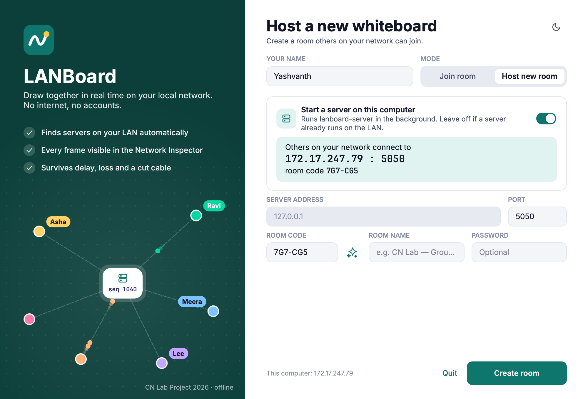

1. Start `lanboard-client`, enter **Your name** and choose **Host new room**.
2. Tick **Start a server on this computer** if no server runs yet (otherwise enter its address and port).
3. Keep the generated **room code** (e.g. `Y74-2ZX`, letters that cannot be confused with digits) or type your own; optionally give a room name and a **password**.
4. Click **Create room**. You become the owner. Tell the others the address and code shown, or use **Invite** in the top bar (popover shown below).

### 12.5 Joining a session over the LAN

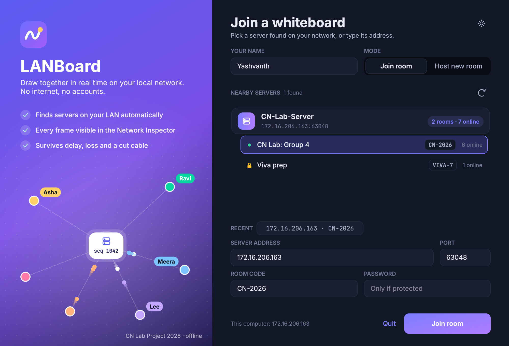

1. Choose **Join room** and enter your name.
2. Pick the room under **Nearby servers** (double-click joins), or type the server's IP address, port (5050) and the room code.
3. For a protected room enter the password (or wait for the prompt).
4. The board, the participant list and the recent chat appear at once; you are an editor unless the owner changes it.

Quick test without the dialog: `lanboard-client --host 192.168.1.20 --user bob --room K7Q-2MX` (add `--create` to create the room).

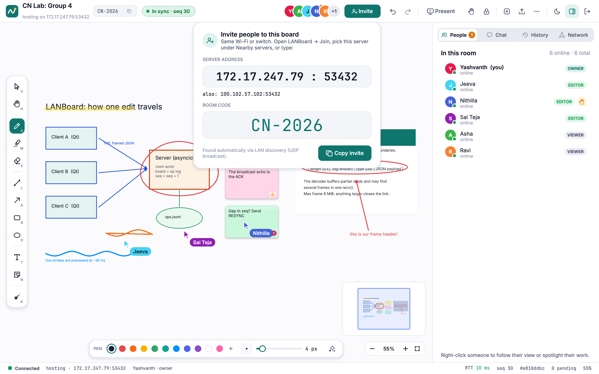

### 12.6 The main window

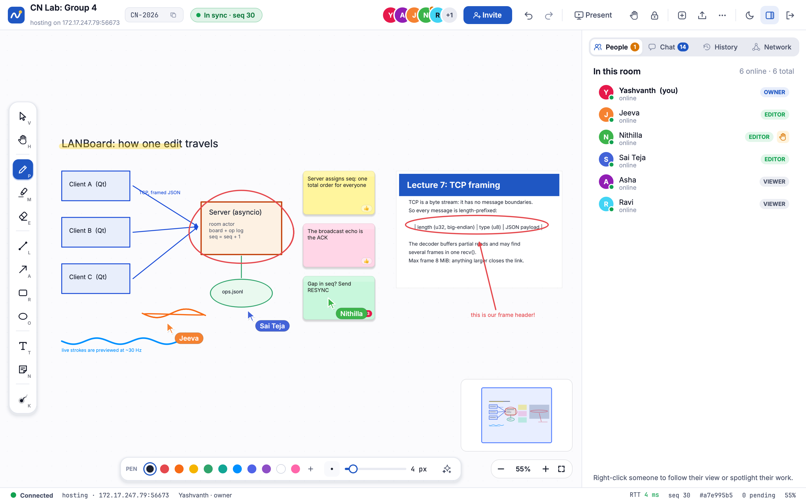

* **Top bar**: room name and server address, room code (click to copy), the **sync badge**, participant avatars, *Invite*, undo/redo, *Present*, raise hand, lock (owner), insert image/PDF, export, the *More* menu (saved boards, save, clear, room settings, grid, minimap, shortcuts), theme, side panel and *Leave*.
* **Status strip**: connection state, `TCP host:port`, your name and role, RTT, current seq, board hash, pending ops and zoom.

### 12.7 Drawing and editing

| Tool | Key | Use |
|---|---|---|
| Select | <kbd>V</kbd> | click or drag a box; move, resize with handles, recolour, delete (<kbd>Del</kbd>), bring forward/back (<kbd>Ctrl</kbd>+<kbd>]</kbd>/<kbd>[</kbd>) |
| Pan | <kbd>H</kbd> | move the board (also <kbd>Space</kbd>+drag; wheel to zoom) |
| Pen / Highlighter | <kbd>P</kbd> / <kbd>M</kbd> | freehand; hold still at the end for **Smart Ink** (snaps to a line, arrow, rectangle or ellipse) |
| Eraser | <kbd>E</kbd> | drag over objects; everything touched is removed in one undoable step |
| Line, Arrow, Rectangle, Ellipse | <kbd>L</kbd> <kbd>A</kbd> <kbd>R</kbd> <kbd>O</kbd> | drag to draw; <kbd>Shift</kbd> constrains |
| Text, Sticky note | <kbd>T</kbd> / <kbd>N</kbd> | click to place and type; click a sticky's thumb to vote |
| Laser pointer | <kbd>K</kbd> | fading trail visible to everyone, never saved |

Colours, stroke width and fill are chosen in the **style bar** at the bottom (a palette plus a custom colour picker). <kbd>Alt</kbd>+click sends a "look here" ping. Undo <kbd>Ctrl</kbd>+<kbd>Z</kbd> and redo <kbd>Ctrl</kbd>+<kbd>Shift</kbd>+<kbd>Z</kbd> act only on your own edits (§6.8). Other users' cursors and live strokes are shown in their colours; hover an object to see who drew it.

### 12.8 Chat

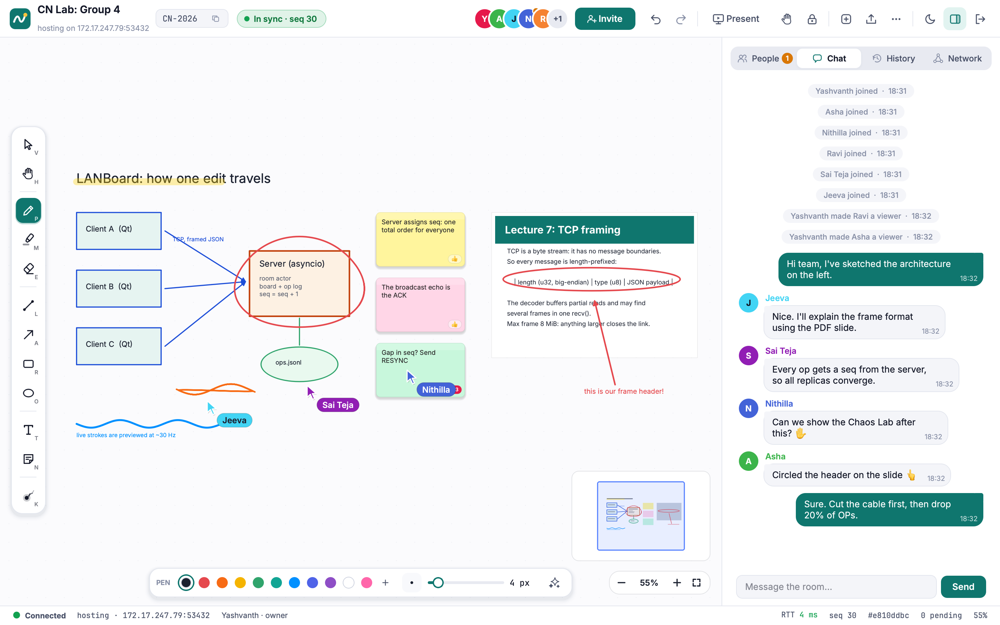

Open the **Chat** tab (<kbd>Ctrl</kbd>+<kbd>Enter</kbd> focuses the input), type and press Enter. Messages appear in order with the sender's name and the server time (HH:MM); joins, leaves, saves and role changes appear as grey system notices. A badge counts unread messages while the tab is hidden. Chat needs a connection; while reconnecting a notice says so.

### 12.9 Participants, roles and owner controls

The **People** tab lists everyone with colour, role and online state; joins, leaves and role changes also appear as toasts. Right-click a person to **follow** their view or **spotlight** their work. The owner's menu additionally offers *Make editor/viewer*, *Make presenter* and *Kick from room*. **Lock** (top bar) makes the board read-only for everyone else; **Room settings** (More menu) changes the name, the password and whether editors may clear. **Present** broadcasts your viewport so followers see what you see.

### 12.10 Saving, loading, exporting and clearing

* **Save board** (<kbd>Ctrl</kbd>+<kbd>S</kbd>) stores a named copy on the server; **Saved boards…** lists them, and the owner can load one for everyone.
* **Export** (<kbd>Ctrl</kbd>+<kbd>E</kbd>) writes PNG, SVG or PDF to your computer.
* **Clear board…** (owner, or editors if allowed) asks for confirmation; it can be undone.
* The board itself is saved continuously by the server and survives restarts.

### 12.11 Time-lapse history

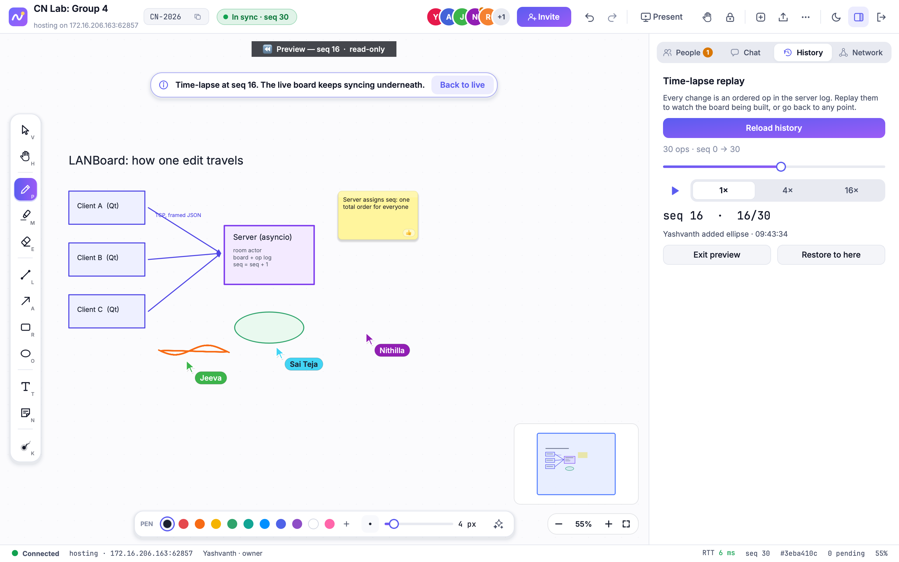

Open **History** and press **Reload history**, then drag the slider or press play (1×, 4×, 16×). The banner shows the previewed seq; **Back to live** or **Exit preview** returns. The owner can **Restore to here**, which makes that version the live board for everyone.

### 12.12 Network panel: HUD, Inspector and Chaos Lab

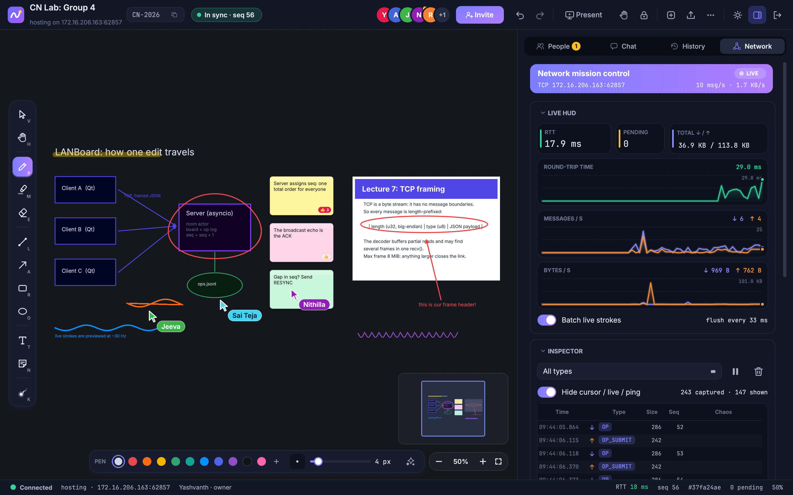

* **Live HUD**: RTT sparkline, messages/s and bytes/s in and out, totals, pending ops, and the *Batch live strokes* switch (flush every 33 ms).
* **Inspector**: a Wireshark-style list of every frame this client sends and receives (time, direction, type, size, seq, chaos tag) with a decoded JSON view and type filter.
* **Chaos Lab**: injects latency, jitter, duplicates and OP drops into *received* frames, or **cuts the cable** (aborts the socket). Watch the badge go to "healing" and back to "In sync": the recovery of §6.4 and §8.2 in action.

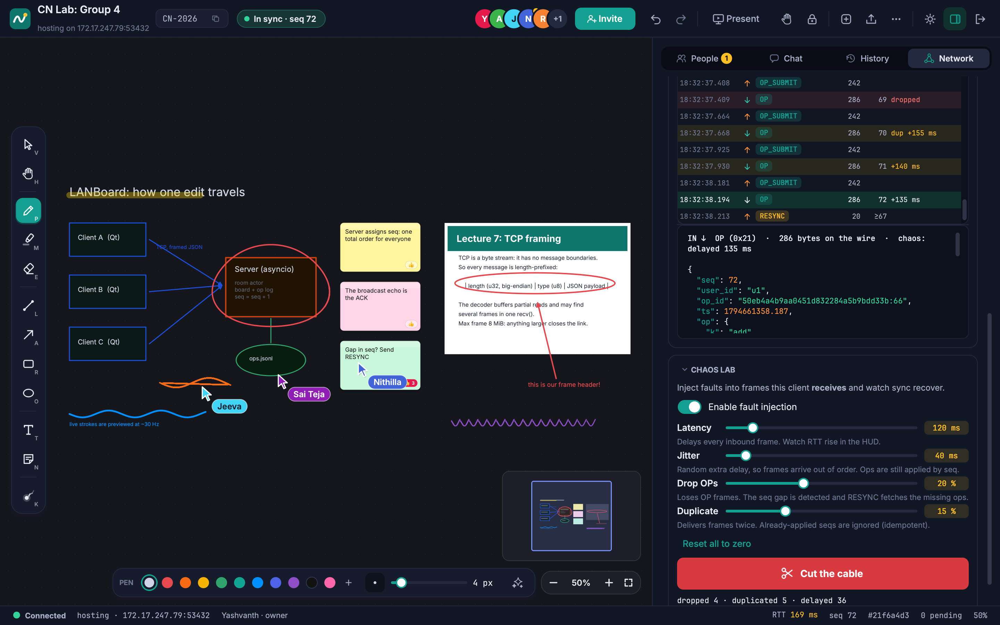

### 12.13 Keyboard shortcuts

Press <kbd>?</kbd> or <kbd>F1</kbd> for the cheat sheet. Besides the tool keys: <kbd>Ctrl</kbd>+<kbd>A</kbd> select all, <kbd>Ctrl</kbd>+<kbd>0</kbd> reset zoom, <kbd>Ctrl</kbd>+<kbd>1</kbd> fit board, <kbd>Ctrl</kbd>+<kbd>B</kbd> side panel, <kbd>Ctrl</kbd>+<kbd>Shift</kbd>+<kbd>M</kbd> minimap, <kbd>F11</kbd> full screen. On macOS <kbd>Ctrl</kbd> is <kbd>⌘</kbd>.

### 12.14 Troubleshooting

| Symptom | Cause and fix |
|---|---|
| "Can't reach the server" | wrong IP/port, server not running, or firewall (§12.3). Use the address printed by the server. |
| Nearby servers stays empty | broadcast blocked (client isolation, firewall on UDP 5051, different subnet). Type the address manually. |
| "That room code is already taken" | create with another code, or switch to Join. |
| "Room not found" | code typo (codes are case-sensitive), or a different server. |
| Wrong password prompt repeats | the password is wrong; ask the owner. |
| Banner "Reconnecting" | network interrupted; keep drawing, edits are sent when the link is back. |
| Tools greyed out | you are a viewer or the board is locked by the owner. |
| "Slow down: too many edits per second" | more than 120 ops/s; wait a moment. |

## 13. Testing

### 13.1 Test suite overview

`.venv/bin/python -m pytest -q` runs **318 tests** in about 90 s (all passed on 14 November 2026), headless (`QT_QPA_PLATFORM=offscreen`).

| File | Tests | What it covers |
|---|---|---|
| `test_protocol.py` | 13 | framing: byte-by-byte, many frames per read, split frames, oversize, zero length, bad JSON, multi-part split and assembly |
| `test_model.py` | 40 | apply/no-ops, clear normalisation, replace, paint order, snapshot and hash, determinism under random op sequences, validation |
| `test_undo.py` | 8 | own-work-only undo, redo, skip erased objects, keep others' newer changes, batch = one step |
| `test_server.py` | 44 | room pipeline, permission matrix, rate limit, HASH cadence, dedupe, catch-up vs snapshot, sessions, roles, kick, history caps, persistence and torn lines |
| `test_integration.py` | 30 | real server + bot clients over TCP: join/errors, passwords, roles, lock, kick, timeouts, lagging, resume, RESYNC, saves, chat, blobs, restart and crash recovery, UDP discovery |
| `test_convergence.py` | 2 | random concurrent edits with connection drops (§13.2) |
| `test_net_client.py` | 27 | Qt client: handshake, password retry, fatal errors, reconnect/backoff, PING/RTT, dead link, frame log, Chaos Lab, metrics, discovery |
| `test_controller.py` | 17 | optimistic apply and ack, duplicates and reorder, gap → RESYNC, rejects, offline replay, hash heal, undo, throttling, multi-part |
| `test_e2e_client.py` | 5 | real server thread + real NetClient/SessionController (§13.3) |
| `test_canvas.py`, `test_geometry.py` | 32 + 28 | tools, rendering, export, images/PDF, RDP, hit tests, Smart Ink |
| `test_ui_smoke.py`, `test_auth.py` | 26 + 1 | main window, panels, connect dialog, toasts, themes; challenge–response |
| `test_demo_robustness.py` | 3 | busy port gives a clear error, LAN address listing, reusing only a real LANBoard server |
| `test_e2e_app.py` | 39 | every user-facing feature through real windows against a real server (§13.3) |
| `test_dashboard.py` | 3 | server dashboard: rooms, people, offline sessions, op rate, log ring, `--dashboard` flag |

### 13.2 Convergence and chaos tests

`test_convergence.py` lets six bots edit one board for 3 s at 40 ops/s each with random adds, moves, recolours, deletes, restores and batches, while each randomly drops its connection, edits offline and resumes. At the end every replica must hash exactly to the server's board, with no hash mismatch and no invalid op. The *tiny-history* variant shrinks the server history to 8 ops so most resumes are healed with a SNAPSHOT instead of OP_BATCH.

### 13.3 End-to-end tests with the real client

`test_e2e_client.py` runs the asyncio server on a background thread (like another machine) and real `NetClient` + `SessionController` objects on the Qt loop: two clients drawing concurrently converge with the server; a late joiner gets the board and undo removes only the undoer's work; edits made after a "cut cable" survive; with 30 % drops, 30 % duplicates and 20–60 ms jitter the replica still converges; password and viewer permissions hold.

`test_e2e_app.py` goes one level higher: it runs the real server with two or three complete `MainWindow`s (real `CanvasView`, side panel, toolbars) and drives them with real mouse and keyboard events. Only modal dialogs are answered automatically. Each test checks that the *other* window sees the effect: pen with live preview, shapes, text and sticky notes, eraser, select/move/recolour/delete, undo/redo, live cursors, laser and ping, image and PDF import, export, chat, participants and raised hands, the people menu, viewer role, lock, kick (and that the kicked app cannot rejoin), clear and undo, room settings and password, saves, history scrub/restore/playback, present and follow, ownership hand-over, reconnect with offline edits, leave, the Network tab, sticky votes, keyboard shortcuts, dark mode and LAN discovery. Writing these tests found nine bugs, all fixed (B.6).

### 13.4 Stress tool

`python -m lanboard.tools.bot --host IP --port 5050 --room LOAD --bots 8 --rate 20 --seconds 30` prints throughput, pending ops, RTT and resyncs every second and finally checks every replica's hash against a fresh server SNAPSHOT (results in §7.7).

### 13.5 Packaging smoke test and CI

`packaging/smoke_test.py` starts the *frozen* server on a free port with a scratch data directory, runs the frozen client headless to create a room, runs four bots against it (must print `ALL REPLICAS CONVERGED`) and checks the bundled fonts and pdfium library. The GitHub Actions workflow builds and smoke-tests the bundles on Windows, Linux and macOS.

### 13.6 Manual LAN test checklist

With three or four laptops on a hotspot and mobile data off: discovery lists the server; host and two joiners draw concurrently; a late joiner sees the board; chat with timestamps; Wi-Fi off/on on one laptop (reconnect, offline edits appear); kill the server with Ctrl+C and restart (board and identities kept); viewer, lock and kick; password room; save/load, export, history replay; Chaos Lab drop and cut cable.

## 14. Limitations and future work

* **TLS for the desktop client.** The server supports TLS but the GUI client does not (§10.6); a `QSslSocket` with certificate fingerprint pinning would close this, and would also protect the room verifier.
* **Verifier is password-equivalent.** A SRP/OPAQUE-style protocol would avoid storing and sending an HMAC key.
* **Ban list is in memory only.** Kicked client ids are banned until the server restarts; a persistent ban list, or a "new joiners are viewers" option, would be stronger.
* **Owner offline.** While the owner is disconnected (up to 600 s) nobody can use owner controls.
* **Host-launched server.** A server started from the client's Host screen ends when that client quits; for long sessions run `lanboard-server` separately.
* **Single server.** No replication of the server itself; it is a single point of failure (mitigated by the durable log and client reconnects).
* **Object-level eraser** (removes whole objects, not pixel parts of strokes).
* **Performance numbers** come from loopback runs of the stress tool; there is no automated LAN latency benchmark yet.

## 15. References

1. Python Software Foundation. *asyncio: Asynchronous I/O* — Streams and Transports. docs.python.org/3/library/asyncio.html
2. The Qt Company. *Qt for Python (PySide6)*, `QTcpSocket`, `QUdpSocket`, Graphics View Framework. doc.qt.io/qtforpython-6
3. W. Eddy (ed.). *RFC 9293: Transmission Control Protocol (TCP)*, IETF, 2022 (obsoletes RFC 793, J. Postel, 1981).
4. J. Nagle. *RFC 896: Congestion Control in IP/TCP Internetworks*, 1984 (Nagle's algorithm; `TCP_NODELAY`).
5. J. Postel. *RFC 768: User Datagram Protocol*, 1980; J. Mogul. *RFC 919: Broadcasting Internet Datagrams*, 1984.
6. L. Lamport. "Time, Clocks, and the Ordering of Events in a Distributed System." *Communications of the ACM* 21(7), 1978.
7. F. B. Schneider. "Implementing Fault-Tolerant Services Using the State Machine Approach: A Tutorial." *ACM Computing Surveys* 22(4), 1990.
8. X. Défago, A. Schiper, P. Urbán. "Total Order Broadcast and Multicast Algorithms: Taxonomy and Survey." *ACM Computing Surveys* 36(4), 2004.
9. C. Percival, S. Josefsson. *RFC 7914: The scrypt Password-Based Key Derivation Function*, 2016; H. Krawczyk et al. *RFC 2104: HMAC*, 1997.
10. U. Ramer (1972); D. Douglas, T. Peucker (1973). Line simplification algorithm (RDP).
11. C. Mohan et al. "ARIES: A Transaction Recovery Method Supporting Fine-Granularity Locking and Partial Rollbacks Using Write-Ahead Logging." *ACM TODS* 17(1), 1992.
12. C. Ellis, S. Gibbs. "Concurrency Control in Groupware Systems." *SIGMOD* 1989 (OT); M. Shapiro et al. "Conflict-free Replicated Data Types." *SSS* 2011.
13. PyInstaller manual, pyinstaller.org; pypdfium2, github.com/pypdfium2-team/pypdfium2.

## Appendix A. Configuration constants

All tunables live in `common/config.py` unless another file is named. The build script checks every row of this table against the source.

| Constant | Value | File | Meaning |
|---|---|---|---|
| `PROTO_VERSION` | `1` | `common/config.py` | wire protocol version, checked in HELLO/CHALLENGE |
| `TCP_PORT` | `5050` | `common/config.py` | default server port |
| `DISCOVERY_PORT` | `5051` | `common/config.py` | UDP discovery port |
| `DISCOVERY_MAGIC` | `"LANBOARD_DISCOVER_V1"` | `common/config.py` | marker in discovery datagrams |
| `MAX_FRAME` | `8388608` (8 MiB) | `common/config.py` | largest frame (type + payload) |
| `READ_CHUNK` | `65536` | `common/config.py` | server read size |
| `PART_BYTES` | `1048576` (1 MiB) | `common/config.py` | target size of one SNAPSHOT/HISTORY/OP_BATCH part |
| `MAX_OP_BYTES` | `4194304` (4 MiB) | `common/config.py` | largest OP frame (`TOO_LARGE`) |
| `PING_INTERVAL` | `3.0` | `common/config.py` | seconds between client PINGs |
| `CLIENT_TIMEOUT` | `12.0` | `common/config.py` | silence before a link is considered dead (both ends) |
| `SESSION_TTL` | `600.0` | `common/config.py` | seconds a disconnected session stays resumable |
| `RECONNECT_BACKOFF` | `(0.5, 1.0, 2.0, 4.0, 5.0)` | `common/config.py` | reconnect delays (× 0.8–1.2 jitter) |
| `LIVE_FLUSH_MS` | `33` | `common/config.py` | live-stroke batching interval |
| `CURSOR_MIN_INTERVAL_MS` | `50` | `common/config.py` | cursor throttle (20 Hz) |
| `SEND_QUEUE_MAX` | `4000` | `common/config.py` | per-client outbound frames before `lagging` |
| `OPS_PER_SEC_LIMIT` | `120` | `common/config.py` | op token bucket per user |
| `HASH_EVERY_OPS` | `25` | `common/config.py` | HASH checkpoint interval |
| `HISTORY_MAX_OPS` | `100000` | `common/config.py` | ops kept per room |
| `HISTORY_MAX_BYTES` | `33554432` (32 MiB) | `common/config.py` | op JSON kept per room |
| `AUTOSAVE_EVERY_OPS` | `50` | `common/config.py` | compaction after this many ops … |
| `AUTOSAVE_INTERVAL` | `10.0` | `common/config.py` | … or this many seconds |
| `MAX_USERNAME` | `24` | `common/config.py` | username length |
| `MAX_ROOM_CODE` | `32` | `common/config.py` | room code length |
| `MAX_CHAT_LEN` | `2000` | `common/config.py` | chat message length |
| `CHAT_HISTORY_MAX` | `1000` | `common/config.py` | chat messages kept per room |
| `MAX_TEXT_LEN` | `5000` | `common/config.py` | text/sticky content length |
| `MAX_STROKE_POINTS` | `20000` | `common/config.py` | numbers in one stroke's point list |
| `MAX_COORD` | `1000000` | `common/config.py` | coordinate bound |
| `MAX_OBJECTS` | `50000` | `common/config.py` | objects per board |
| `MAX_BATCH_OPS` | `500` | `common/config.py` | ops in one batch |
| `MAX_BLOB` | `8388608` (8 MiB) | `common/config.py` | image size |
| `BLOB_CHUNK` | `196608` (192 KiB) | `common/config.py` | raw bytes per blob chunk |
| `DEDUPE_MAX` | `4096` | `server/room.py` | remembered op ids per session |
| `CATCHUP_MAX_OPS` | `5000` | `server/room.py` | longer gaps get a SNAPSHOT |
| `OP_BATCH_CHUNK` | `500` | `server/room.py` | ops per OP_BATCH frame |
| `JOIN_CHAT_TAIL` | `200` | `server/room.py` | chat messages in JOINED |
| `LIVE_PER_SEC` | `240` | `server/room.py` | ephemeral frames per user per second |
| `CHAT_PER_SEC` | `5` | `server/room.py` | chat rate (burst 2×) |
| `MAX_UPLOADS` | `4` | `server/room.py` | concurrent blob uploads per connection |
| `MAX_AUTH_FAILURES` | `10` | `server/server.py` | wrong passwords per connection |
| `FLUSH_GRACE` | `5.0` | `server/server.py` | seconds to flush before a forced close |
| `MAX_PROBE` | `2048` | `server/discovery.py` | largest accepted discovery probe |
| `MAX_ROOMS_LISTED` | `40` | `server/discovery.py` | rooms in one discovery reply |
| `GAP_TIMEOUT_MS` | `400` | `client/controller.py` | wait for a missing seq before RESYNC |
| `MAX_REORDER` | `256` | `client/controller.py` | buffered out-of-order ops before RESYNC |
| `RESEND_PER_TICK` | `100` | `client/controller.py` | offline ops resent per second |
| `PROBE_INTERVAL_MS` | `2000` | `client/discovery.py` | discovery probe interval |
| `ENTRY_TTL` | `6.0` | `client/discovery.py` | forget a silent server after this |
| `MAX_UNDO` | `500` | `common/undo.py` | undo stack size |

## Appendix B. Requirements traceability

Every requirement and rubric item of the brief (docs/SPEC.md), how LANBoard meets it, where the code is (paths below `src/lanboard/`) and which tests cover it (`tests/`). Weaknesses found during this audit are marked **⚠** and listed below the table (B.1–B.6) and in §14.

| Requirement | How we meet it | Code | Tests |
|---|---|---|---|
| **1.1** Freehand, erase, colour | pen/highlighter, object eraser, palette + custom colour | `canvas/tools.py` `PenTool`, `EraserTool`; `ui/toolbar.py` `StyleBar` | `test_canvas::test_pen_drag_adds_stroke`, `test_eraser_drag_deletes`, `test_ui_smoke::test_style_bar_is_contextual` |
| **1.2** Real-time sync | OP_SUBMIT → OP broadcast; live preview every 33 ms | `controller.submit`, `send_live`; `room.Room.submit` | `test_e2e_client::test_two_clients_sync_and_converge`, `test_controller::test_live_strokes_batched`, `test_canvas::test_remote_live_stroke_replaced_by_commit` |
| **1.3** Server receives, validates, distributes, handles concurrency | 10-step pipeline, permission + validation + rate limit, sequencer | `room.Room.submit`, `check_permission`; `model.validate_op` | `test_server::test_pipeline_assigns_seq_and_broadcasts_to_all`, `test_permission_matrix`, `test_invalid_op_rejected`, `test_rate_limit`, `test_model::test_validation_rejects` |
| **1.4** Consistent shared canvas | deterministic apply in seq order; HASH checkpoints | `model.Board.apply`, `Board.hash`; `controller._check_hash` | `test_model::test_determinism`, `test_convergence`, `test_integration::test_hash_broadcast`, `test_controller::test_hash_mismatch_heals` |
| **1.5** Permissioned clear; save and restore | clear = owner (or editors_can_clear); SAVE/LOAD; automatic persistence; export | `room.check_permission`, `on_save`, `on_load`; `persistence.RoomStore`; `canvas/view.export` | `test_integration::test_clear_permission`, `test_save_list_load`, `test_restart_restores_board_and_sessions`, `test_killed_server_recovers_from_log`, `test_server::test_editors_can_clear_setting`, `test_canvas::test_export` |
| **2.1** Host a session; join by LAN address + room code | create/join in JOIN; host screen with code generator and server launcher; discovery | `server.ClientConnection.on_join`; `ui/connect_dialog.py`; `ui/server_launcher.py`; `client/discovery.py` | `test_integration::test_create_join_and_errors`, `test_udp_discovery`, `test_net_client::test_handshake_reaches_joined`, `test_ui_smoke::test_connect_dialog_builds_and_validates` |
| **2.2** Participant list; join/leave notices | participants in JOINED; USER_JOINED/LEFT/UPDATE; system chat; toasts | `room.admit`, `detach`, `remove_session`; `ui/participants.py` | `test_integration::test_create_join_and_errors`, `test_resume_gets_op_batch_and_same_identity`, `test_ui_smoke::test_participants_render`, `test_join_leave_and_role_toasts` |
| **2.3** Usernames; distinguish users | unique names per room; server-assigned colours; live cursors; authorship lens/spotlight | `server.allocate_user`; `room.unique_username`; `canvas/view.py` cursors | `test_server::test_unique_usernames`, `test_owner_is_forced_by_server`, `test_canvas::test_remote_live_stroke_replaced_by_commit`, `test_spotlight_dims_other_users` |
| **2.4** Join/leave without disruption; newcomer gets state | `admit` without await; SNAPSHOT (multi-part) | `room.admit`, `send_snapshot`, `snapshot_frames` | `test_integration::test_late_join_gets_snapshot`, `test_late_join_when_snapshot_exceeds_max_frame`, `test_e2e_client::test_late_joiner_and_undo_isolation` |
| **3.1** Transmit ops through sockets | framed TCP; OP_SUBMIT | `net.NetClient.send`; `protocol.encode` | `test_protocol` (13), `test_net_client::test_frame_log_sizes_and_fields` |
| **3.2** Broadcast to other clients | encode once, queue for all members | `room.broadcast_frame` | `test_server::test_pipeline_assigns_seq_and_broadcasts_to_all`, `test_integration::test_concurrent_ops_are_totally_ordered` |
| **3.3** Concurrent editing without lost updates | single sequencer, LWW by seq, tombstones, optimistic view rebuilt | `room.submit`; `controller._apply_confirmed`, `_rebuild_view` | `test_convergence` (2), `test_controller::test_foreign_op_while_pending_keeps_both`, `test_integration::test_concurrent_ops_are_totally_ordered` |
| **3.4** Ordering; delayed, duplicated, missing updates | seq; reorder buffer; duplicate drop; RESYNC; op_id dedupe | `controller._on_op`, `_request_resync`; `room.on_resync`, `send_catch_up` | `test_controller::test_duplicates_dropped_and_reorder`, `test_gap_triggers_resync`, `test_integration::test_duplicate_submit_is_deduplicated`, `test_resync_fills_gap`, `test_e2e_client::test_chaos_drop_and_duplicate_still_converge` |
| **3.5** Detect disconnects, timeouts, reconnections | PING 3 s; 12 s watchdogs; backoff; session TTL; lagging | `server.Server._housekeeping`; `net._check_liveness`, `_schedule_reconnect`; `room.expire_sessions` | `test_integration::test_silent_client_times_out`, `test_slow_reader_is_dropped_as_lagging`, `test_net_client::test_silent_link_is_declared_dead`, `test_reconnect_backoff_keeps_retrying_while_server_down`, `test_server::test_session_expiry` |
| **4.1** Group chat | CHAT_SEND / CHAT; chat panel | `controller.send_chat`; `room.on_chat_send`; `ui/chat.py` | `test_integration::test_chat`, `test_ui_smoke::test_chat_message_appears` |
| **4.2** Messages via server to all | `_add_chat` broadcast, persisted to `chat.jsonl` | `room._add_chat` | `test_integration::test_chat`, `test_e2e_client::test_two_clients_sync_and_converge` |
| **4.3** Chronological history, username, timestamp | server id + timestamp; 1000 kept, last 200 in JOINED; HH:MM display | `room.on_chat_send`; `ui/chat.format_time` | `test_ui_smoke::test_chat_message_appears`, `test_server::test_chat_is_capped_and_stamped` |
| **5.1** State representation | objects + ops model with tombstones and rev | `common/model.py` | `test_model` (40) |
| **5.2** State sync for new clients | JOINED + SNAPSHOT, atomic multi-part | `room.send_snapshot`; `controller._on_snapshot`; `protocol.PartAssembler` | `test_server::test_admit_sends_joined_then_snapshot`, `test_snapshot_split_into_parts`, `test_controller::test_multipart_snapshot_applied_atomically` |
| **5.3** Recovery after disconnection | resume token + last_seq → OP_BATCH or SNAPSHOT; offline queue (B.1, fixed) | `server.on_join` (resume); `room.send_catch_up`; `controller._on_joined`, `_pump_resend` | `test_integration::test_resume_gets_op_batch_and_same_identity`, `test_resume_too_old_gets_snapshot`, `test_e2e_client::test_offline_edits_survive_cut_cable`, `test_controller::test_offline_edits_replayed_on_rejoin` |
| **5.4** Undo/redo with defined multi-user behaviour | per-user stacks, filtered inverse ops (§6.8) | `common/undo.py`; `controller.undo`, `redo` | `test_undo` (8), `test_controller::test_undo_redo_roundtrip`, `test_clear_sent_as_clear_but_undoable`, `test_e2e_client::test_late_joiner_and_undo_isolation` |
| **R1** Client–server over TCP/IP, LAN only | central server; no Internet use | `server/server.py`; `client/net.py` | `test_integration`, `test_e2e_client` (no automated "Internet off" test: manual checklist §13.6) |
| **R2** Message format; transport justified; framing and delivery | §3, §4 | `common/messages.py`, `common/protocol.py` | `test_protocol` (13) |
| **R3** GUI: canvas, toolbar, participants, chat, session controls | main window and panels | `ui/main_window.py` and `ui/*` | `test_ui_smoke::test_main_window_builds`, `test_tool_buttons_call_canvas` |
| **R4** Low delay, little traffic | batching, throttling, RDP, NODELAY, deltas, encode once | `controller.send_live`, `send_cursor`; `canvas/tools.PenTool._simplified` | `test_controller::test_live_strokes_batched`, `test_cursor_throttled`, `test_geometry::test_rdp_*`, `test_ui_smoke::test_hud_and_batching_toggle` (no automated latency benchmark) |
| **R5** Many clients, concurrent ops, no corruption | one event loop, bounded queues, rate limits | `server/server.py`, `server/room.py` | `test_convergence`, `test_integration::test_slow_reader_is_dropped_as_lagging`, stress tool §7.7 |
| **R6** Access control, protected workspace | password rooms, roles, lock, kick, server-side checks **⚠** (B.2 open; B.3, B.4 fixed) | `common/auth.py`; `room.check_permission`, `on_kick`, `on_room_settings` | `test_auth`, `test_integration::test_password_room`, `test_viewer_cannot_edit`, `test_lock_room`, `test_kick`, `test_server::test_admin_requires_owner`, `test_e2e_client::test_password_and_viewer_permissions` |
| **R7** Platform | cross-platform; bundles for Windows, Linux, macOS | `packaging/lanboard.spec` | `packaging/smoke_test.py` in CI |
| Deliverables: server and client executables | PyInstaller one-folder bundle | `packaging/` | smoke test |

**Weaknesses found by this audit, and their status:**

* **B.1** *(fixed)* After a resume healed with a SNAPSHOT, an op accepted just before the link died stayed in the GUI client's `pending` list forever. `controller._on_op` now settles the server's de-duplicated re-echo (`test_controller::test_ack_after_snapshot_healed_resume_settles_pending`).
* **B.2** *(open, documented)* The desktop client has no TLS; the verifier (an HMAC key) is sent in clear at room creation and password change (§10.6, §14).
* **B.3** *(fixed)* A kicked user could rejoin immediately; kicked client ids are now banned for the server's lifetime (`test_integration::test_kick`).
* **B.4** *(fixed)* `ROOM_SETTINGS` now validates every field before applying any (`test_server::test_room_settings_validated_before_applying`).
* **B.5** *(fixed)* The server dashboard had no automated tests; `test_dashboard.py` now covers it.
* **B.6** *(fixed)* The end-to-end window tests (§13.3) found nine UI-level bugs: Ctrl/Cmd+Enter in a text editor focused chat instead of committing; an image inserted offline never reached others (ops were replayed before the image upload) and showed a raw "unknown blob" error; imports and exports showed duplicate toasts; the "raised a hand" toast never fired; editors could press Present although the server ignores their view; a kicked user could rejoin through "Back to start" (new client id per session); viewers could press Save; viewers' laser pointer was not relayed.

## Appendix C. Areas of responsibility and third-party software

Each member is responsible for understanding, explaining and maintaining one area. Authorship of individual changes is recorded in the git history (see §1.5).

| Member | Area of responsibility |
|---|---|
| Yashvanth S (CS24I1029) | server core: listener, connections, rooms, op pipeline, sessions, persistence, history, dashboard |
| Jeevanandham T (CS24I1035) | protocol and networking: framing, message catalogue, client transport, reconnect, discovery, Chaos Lab, metrics, bot |
| Akula Sai Teja (CS24I1054) | canvas and drawing tools: scene, items, tools, Smart Ink, geometry, undo, export, images/PDF |
| Nithillakrishi P Y (CS24I1039) | UI and collaboration features: main window, connect dialog, panels, chat, participants, history, theme |

Third-party software: PySide6 / Qt for Python (LGPL-3.0); pypdfium2 (Apache-2.0 / BSD-3-Clause); PyInstaller (GPL-2.0 with bootloader exception, build only); pytest and pytest-asyncio (MIT / Apache-2.0, tests only); Inter and JetBrains Mono fonts (SIL OFL 1.1). This document was built with Python-Markdown and headless Google Chrome. AI assistance (Claude) was used during development, as disclosed in §1.5 and in the README.
